# Цель работы

Выполнить этапы внешнего курса, ознакомиться с видеороликами, прикрепленными на сайте, и выполнить задания по ним.

# Задание

Выполнить внешний курс на stepic.

# Выполнение 1 этапа

1) Вопрос: как называется этот курс? Чтобы ответить, выберите правильный ответ нажмите на зелёную кнопку ниже

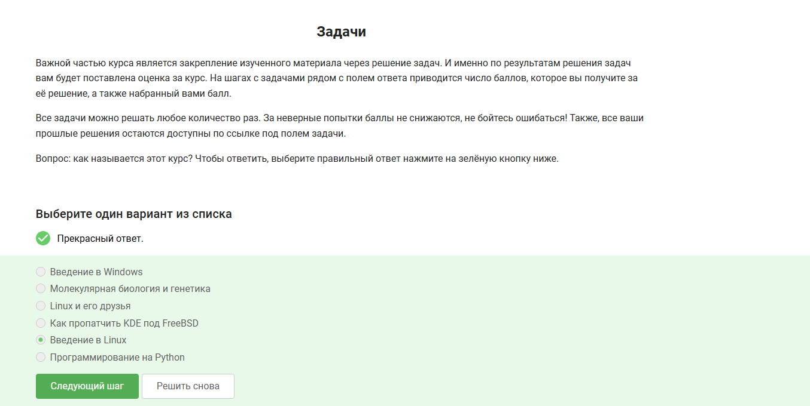

Внешний курс называется Введение в Linux

2) Ответить на вопросы про то, как строится курс 

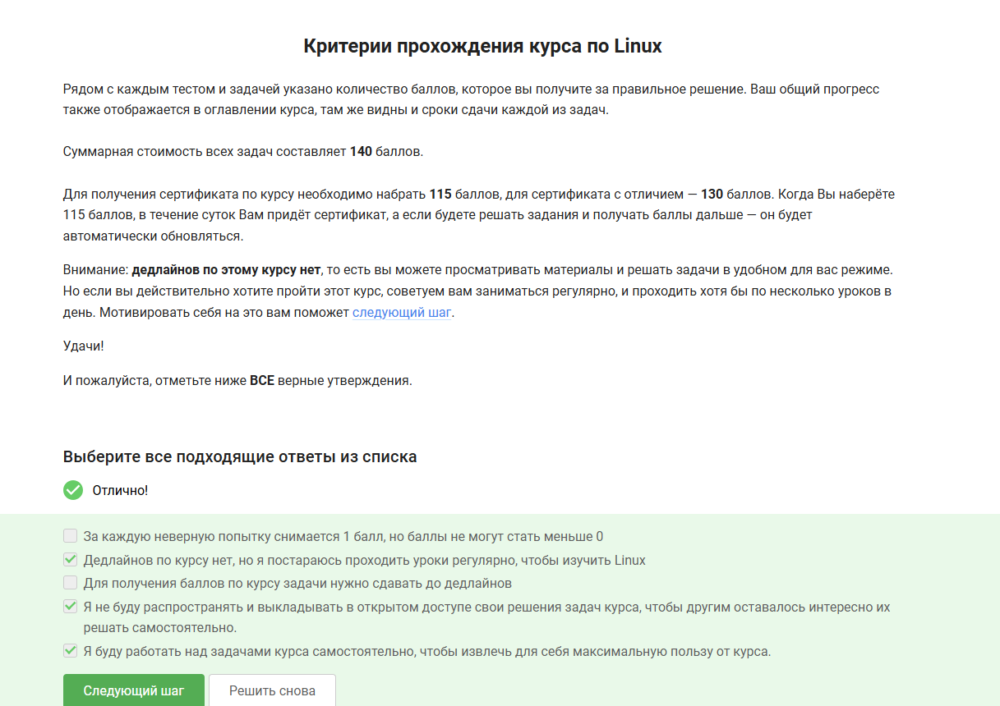

Основами курса являются такие критерии: Дедлайнов по курсу нет, но я постараюсь проходить уроки регулярно, чтобы изучить Linux, Я не буду распространять и выкладывать в открытом доступе свои решения задач курса, чтобы другим оставалось интересно их решать самостоятельно, Я буду работать над задачами курса самостоятельно, чтобы извлечь для себя максимальную пользу от курса.

3) Какую операционную систему вы обычно используете? В таких типах задания (с галочками/чекбоксами/checkbox) вы можете выбирать несколько вариантов ответа (от 0 до всех)! 

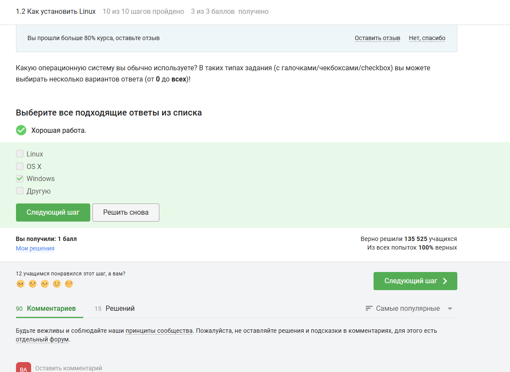

Я чаще всего использую Windows, поскольку эта операционная система установленна как основная на моем пк.

4) Что такое виртуальная машина? Выберите наиболее подходящий ответ! В таком типе заданий (с радиокнопками/radio button) ответ всегда ровно один! 

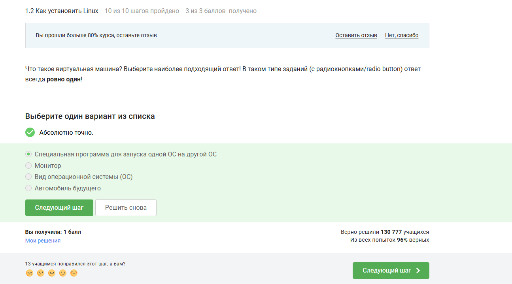

Виртуальна машина - специальная программа для запуска одной ОС на другой ОС. На виртальную машину можно ставить разнообразные операционные системы.

5) Смогли ли вы запустить на своем компьютере Linux? 

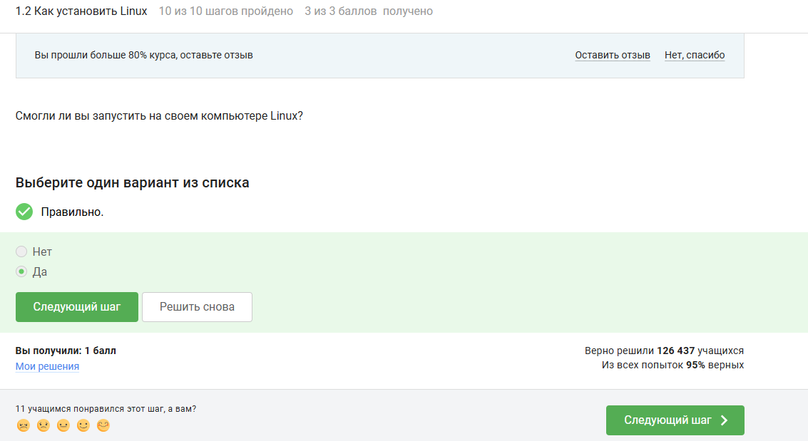

Да, на это была направлена 1 лабораторна работа предмета "архитектура компьютера"

6) Создайте документ в OpenOffice/LibreOffice Writer (аналог Microsoft Word) и напишите в нём шрифтом FreeMono (если такого шрифта у вас нет, то используйте Arial или Times New Roman) одну-единственную строчку:
Hello, Linux! 

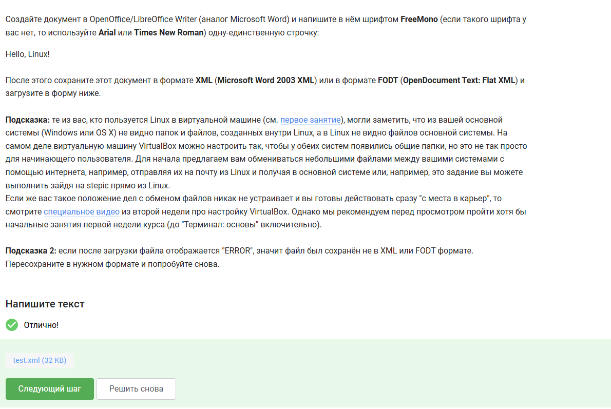

Я создала документ, вписала туда "Hello, Linux!", сохранила в нужном формате и прикрепила в окошко дл крипления файлов

7) Какое расширение имеют установочные пакеты в Linux (Ubuntu)? 

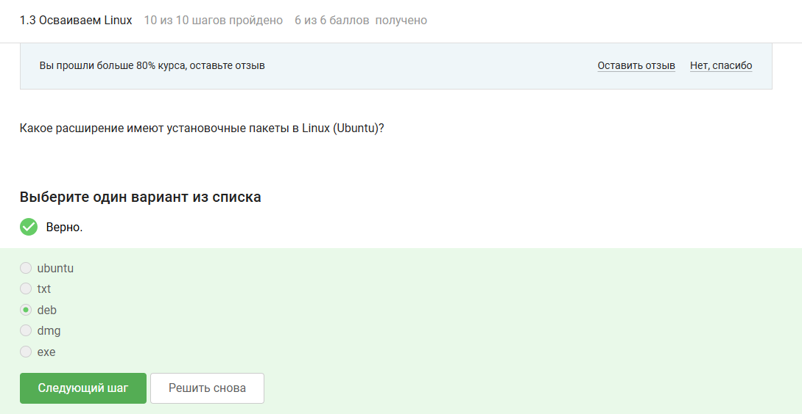

В дистрибутивах Linux, основанных на Debian, установочные пакеты имеют расширение deb. Эти файлы содержат скомпелированные программы, библиотеки и инструкции для менеджера пакетов

8)Запустите, откройте Help → About (или Shift+F1) и напишите ниже первую фамилию (без имени!) из вкладки Authors. Обратите внимание, что в англоязычных текстах обычно имя стоит на первом месте (first name), а фамилия на втором (last name). 

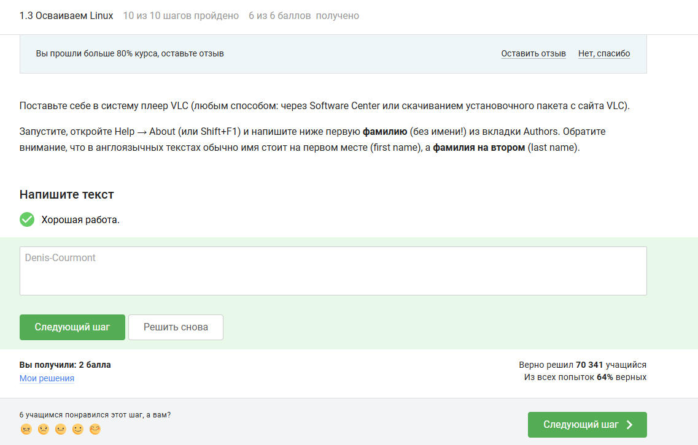

Я запустила, открыла Help → About и посмотрела, какая первая фамилия находитс в вкладке Authors. Ответ: Denis-Courmont

9) Для чего можно использовать приложение Update Manager? 

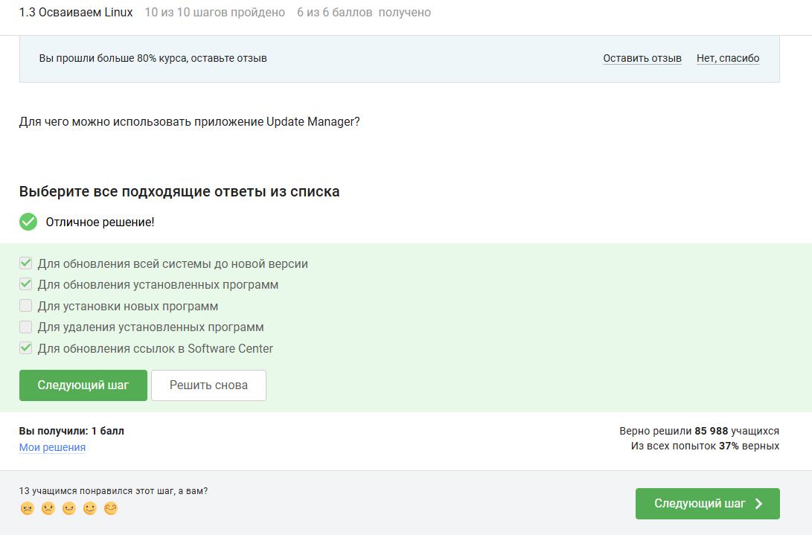

Правильными ответами являются:  Для обновления всей системы до новой версии, Для обновления установленных программ, Для обновления ссылок в Software Center. Эти функции выполняет приложение Update Manager. Остальные варианты не подходят, потому что: Для установки новых программ- задача Software Center, apt install или Snap Store, Для удаления установленных программ - задача Software Center или apt remove 

10) Выберите все синонимы для “командной строки”. 

Синонимами для “командной строки” являются Консоль и Терминал, остальные варианты (Ассоль, Термин) не имеют отношения к слову "командная строка" 

11) Какая команда напечатает в какой директории мы сейчас находимся? 

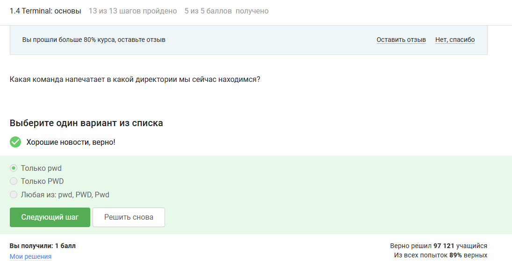

Ответ: Только pwd. Команда чувствительна к регистру: PWD — переменная, а Pwd — несуществующая команда.

12) Укажите, какие из следующих команд полностью эквивалентны команде ls -A --human-readable -l /some/directory 

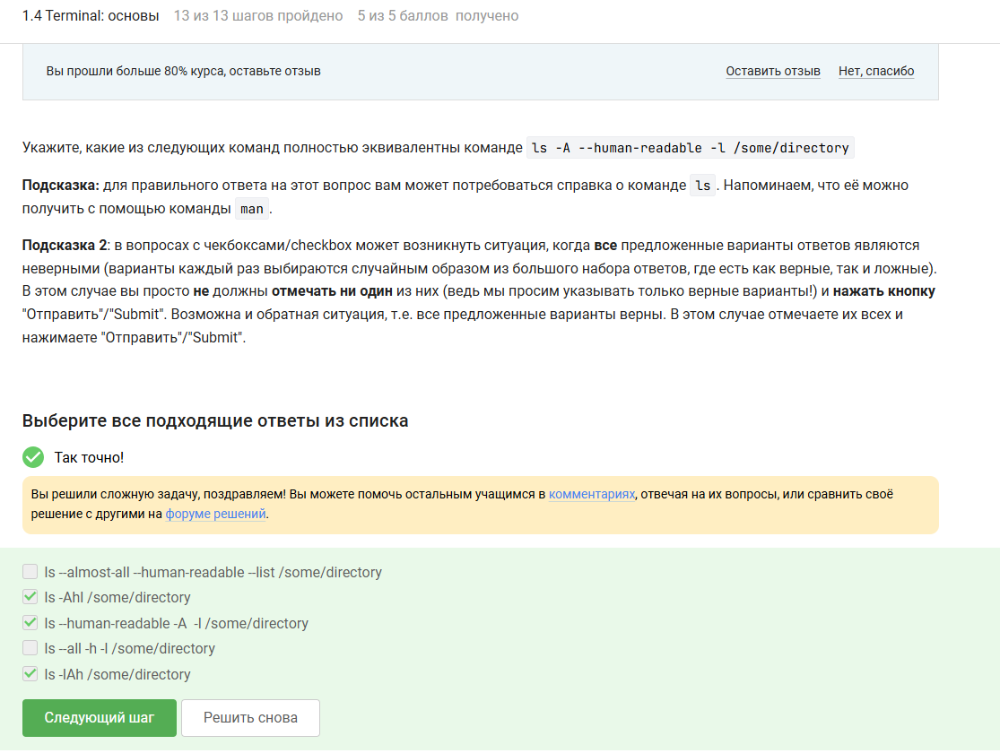

Ответ: ls -Ahl /some/directory, ls --human-readable -A  -l /some/directory, ls -lAh /some/directory. Остальные варианты не подходят, потому что ls --all -h -l /some/directory — --all = -a (включает . и ..), а нужно -A (--almost-all). Не эквивалентно

13) Предположим, что вы находитесь в директории /home/bi/Documents, причем /home/bi — ваша домашняя директория. Какая(ие) команда выведет содержимое /home/bi/Downloads, при этом не показывая содержимое других директорий? 

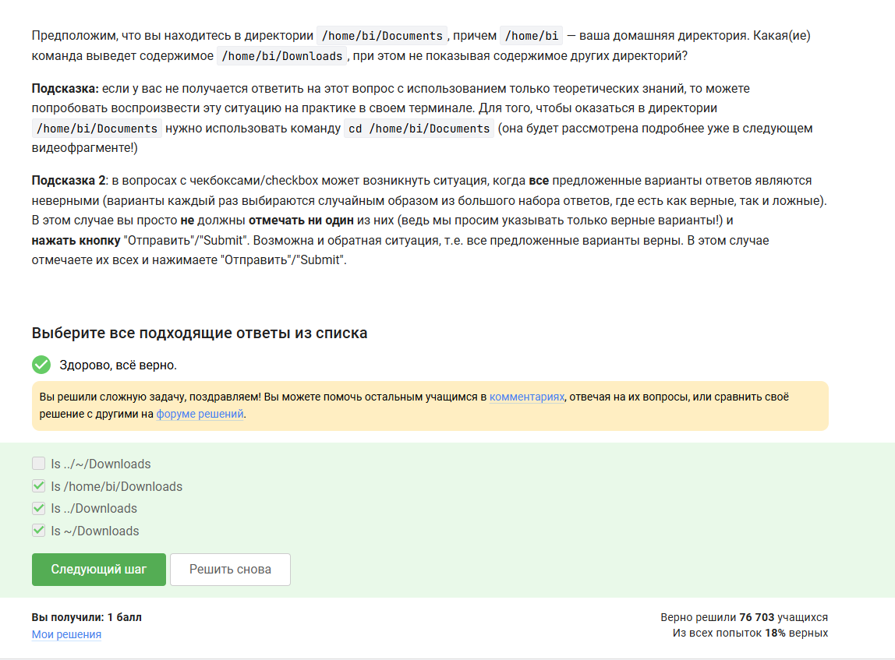

/home/bi/Downloads это абсолютный путь., ../Downloads это относительный: из /home/bi/Documents подняться на уровень выше (/home/bi/) в Downloads. ~/Downloads это ~ = домашняя директория (/home/bi). Не подходит: ls ../~/Downloads это синтаксически неверно (.. и ~ вместе не работают как путь).

14) Какая команда используется для удаления директорий? 

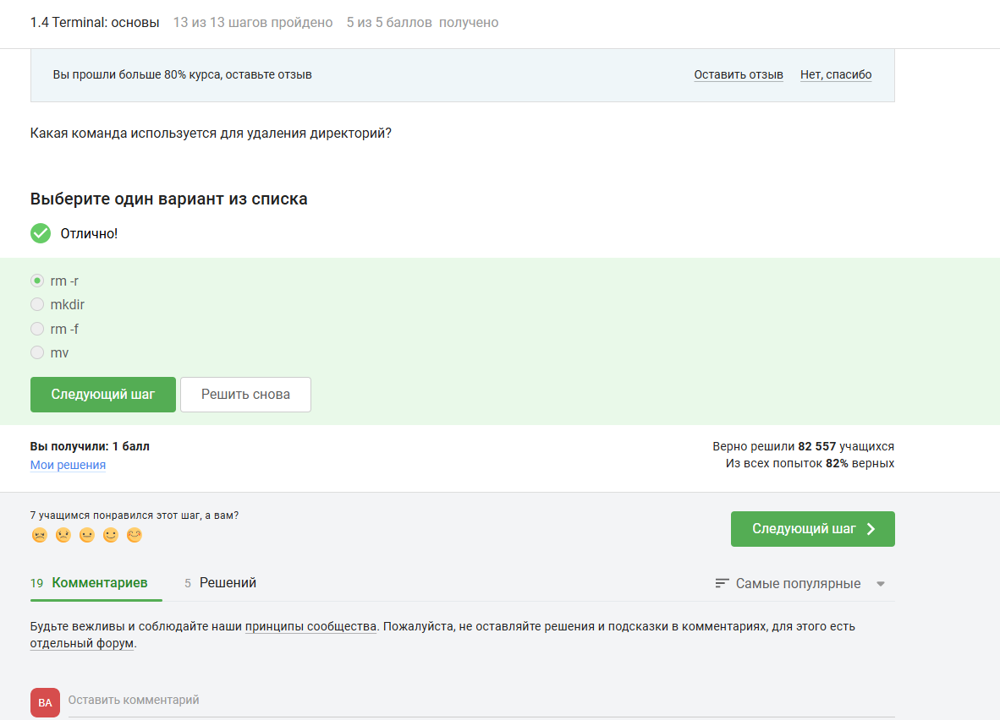

rm -r - удаляет директорию рекурсивно (вместе с содержимым), mkdir - создаёт директории, rm -f - удаляет только файлы (без рекурсии, -f — принудительно), mv - перемещает/переименовывает.

15) Что произойдет, если ввести в терминал команду firefox (для запуска одноименного браузера), а затем ввести туда же команду exit?

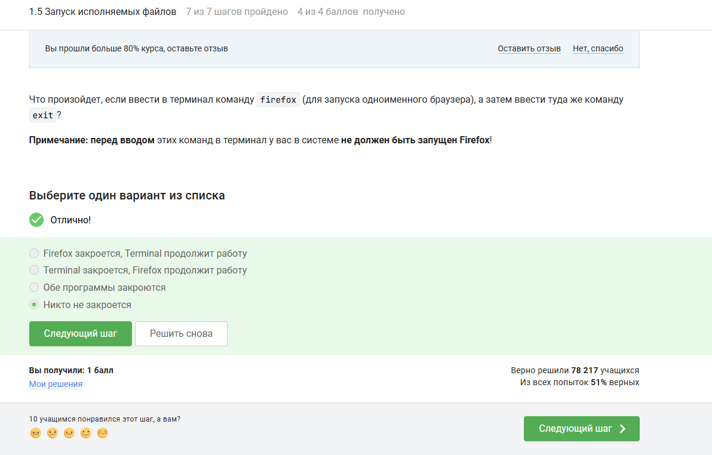

Оба процесса (Firefox и терминал) продолжают существовать, если терминал - это окно, которое не закрывается автоматически после exit

16) Чему эквивалентен запуск программы с &? 

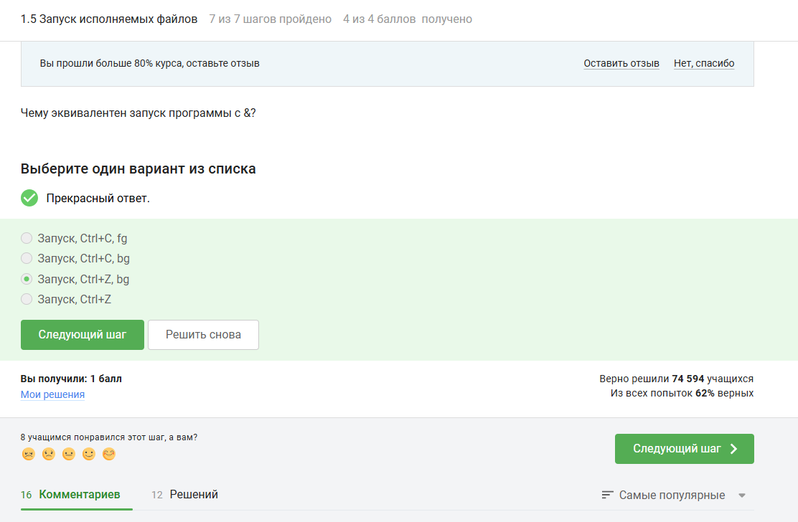

& запускает программу в фоне сразу. Вручную это делается так: Запуск программы (нажимаем Enter), останавливаем её через Ctrl+Z (приостановка), переводим в фон командой bg.

17) Скачайте файл с программой, сделайте его исполняемым, запустите и скопируйте то, что он выведет на экран, в форму ниже. 

Я скачала файл с программой, сделала его исполняемым, запустила и получила такой результат:
2026-05-02 20:54:29
Control sum: 949

18) Куда по умолчанию выводится поток ошибок из программы, запущенной в терминале? 

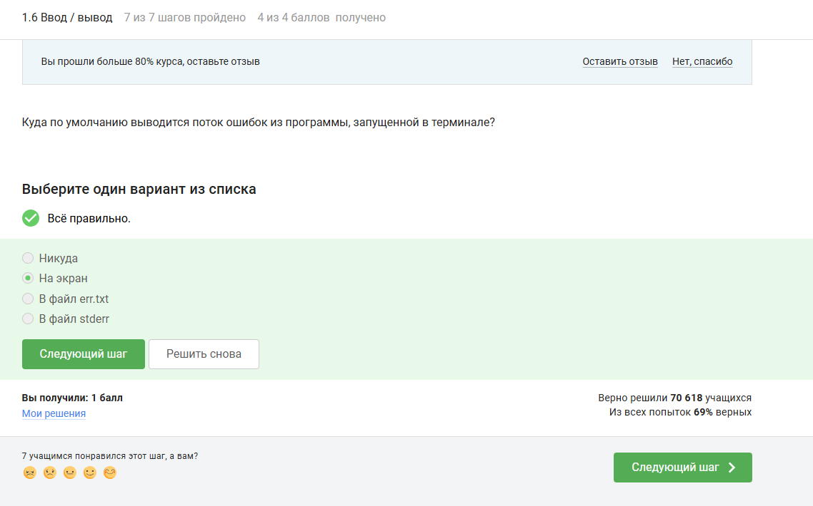

Поток ошибок (stderr) по умолчанию выводится на экран (тот же терминал, что и stdout), но не перенаправляется автоматически в файл.

19) Какие (какая) из команд создадут файл file.txt и запишут в него поток ошибок программы program? Считайте, что в момент запуска программы файл file.txt не существует.

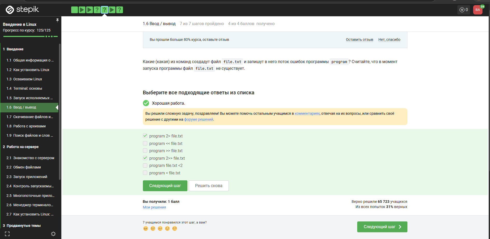

Вернуе варианты: program 2> file.txt, program 2>> file.txt. Остальные варианты не подходят, потому что >> / < / << — работают с stdout или вводом, а не с stderr, program file.txt <2 — синтаксически неверно.

20) Куда деваются сообщения об ошибках (т.е. вывод в stderr) от тех программ, которые объединены в конвейер (pipe)? 

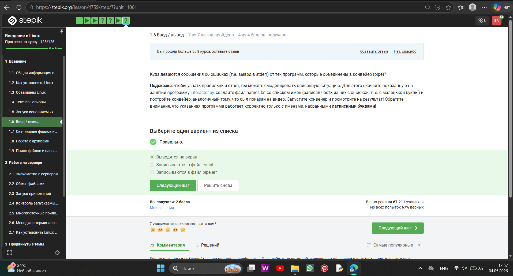

В конвейере (pipe) перенаправляется только stdout между командами. stderr (поток ошибок) по умолчанию остаётся на экране (терминале) и не попадает в конвейер.

21) В каком файле на диске окажется картинка, если для её скачивания были выполнены следующие команды?
cd /home/alex/
wget -P /home/alex/Pictures -O 1.jpg http://example.com/example.jpg 

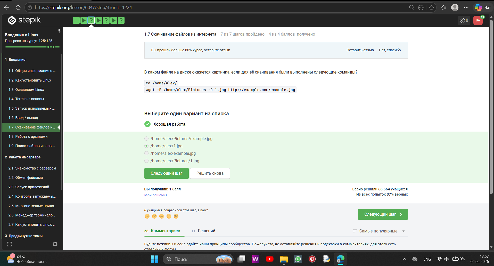

Ключ -O (заглавная буква O) переопределяет выходной файл, игнорируя директорию из -P. Файл сохраняется в текущей рабочей директории (/home/alex/) с именем 1.jpg, а не в Pictures.

22) Какую опцию нужно указать команде wget, чтобы она не выводила никаких сообщений на экран (Resolving.., Connecting to.. и т.д.)? 

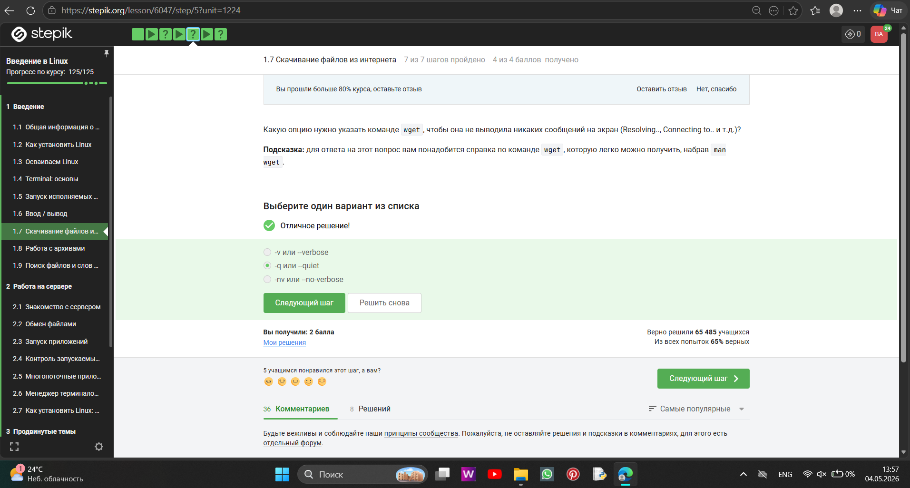

-q (--quiet) - подавляет все сообщения (Resolving..., Connecting... и т.д.).
-v (--verbose) - наоборот, делает вывод подробным (по умолчанию).
-nv (--no-verbose) — отключает подробный вывод, но некоторые сообщения (ошибки, прогресс) могут остаться.

23) Пусть на некоторой web-странице есть ссылки на картинки в форматах png и jpg, а также ссылки на другие страницы сайта (обычные html файлы). Какие файлы будут скачаны на компьютер, если запустить wget -r -l 1 -A jpg и передать в качестве аргумента ссылку на эту web-страницу 

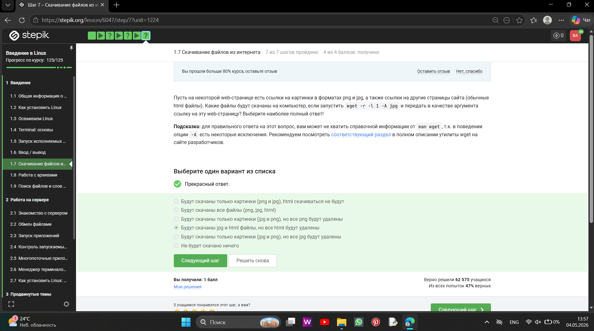

-l 1 - глубина рекурсии 1 тогда wget скачивает стартовую HTML-страницу и все ссылки с неё (jpg и другие html-страницы).
-A jpg - фильтр на сохранение только jpg, но HTML-файлы всё равно сначала скачиваются, чтобы wget мог прочитать ссылки.
После завершения рекурсии wget удаляет HTML-файлы, не подходящие под -A, оставляя только jpg.
png не скачиваются, так как их нет в -A jpg

24) Чем отличаются архиваторы gzip и zip? 

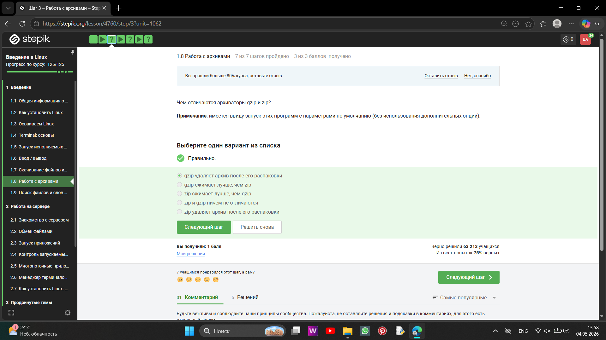

gzip по умолчанию сжимает один файл в .gz, заменяя его архивом. При распаковке (gunzip) архив удаляется, восстанавливая исходный файл. zip по умолчанию создаёт отдельный архивный файл, исходные файлы не удаляет, и при распаковке сам архив остаётся на диске.

25) Какие из перечисленных программ-архиваторов могут создать архив из директории с файлами? 

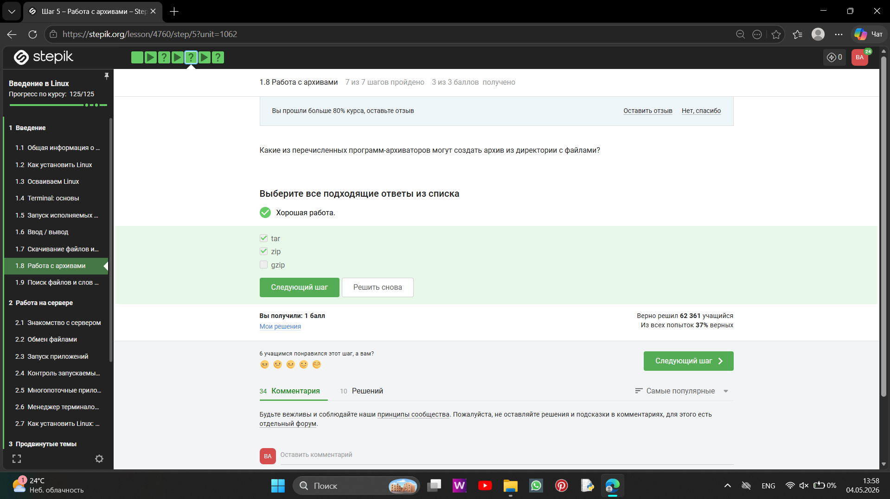

tar - архивирует директории и файлы в один файл (tar-архив), не сжимая.
zip - архивирует + сжимает директории и файлы в один .zip-файл.
gzip - сжимает только один файл, не работает с директорией напрямую (нужен tar для объединения).

26) Какой набор опций нужно указать программе tar, чтобы запаковать файлы в my_archive.tar.bz2? 

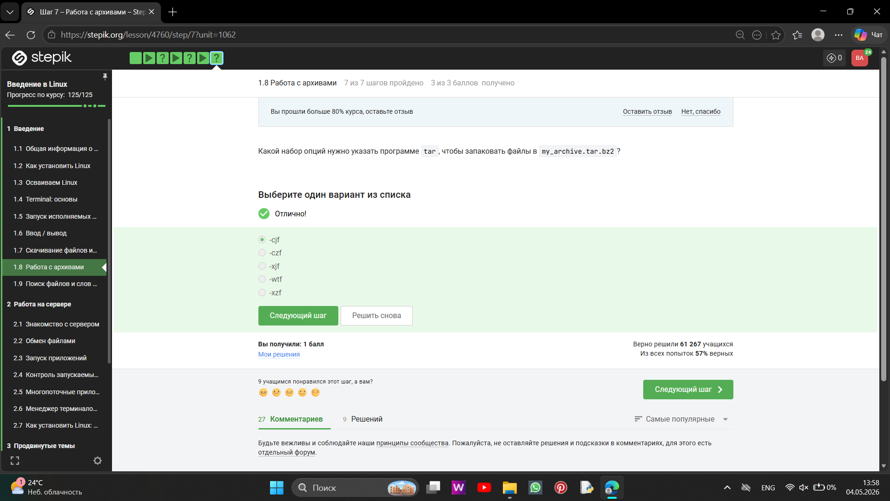

c - создать архив (create).
j - использовать сжатие bzip2 (получится .tar.bz2).
f - указать имя файла архива.

27) Какая маска команды find НЕ найдет файл Alexey.jpeg? 

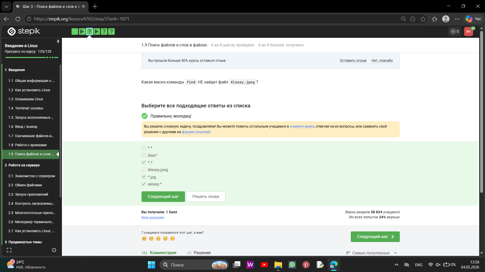

Файл: Alexey.jpeg (с заглавной A).
*.? - ищет расширение из одного символа (.j? нет, в .jpeg — 4 символа).
*.jpg - ищет расширение .jpg, а у нас .jpeg.
alexey.* - ищет имя с маленькой a, а у нас A заглавная.

Остальные варианты найдут:
*.* - любой файл с точкой подойдёт.
Alex* - начинается на Alex
Alexey.jpeg - полное совпадение

28) Предположим, что в файле  text.txt записаны строки, показанные среди вариантов ответа. Отметьте только те из них, которые выведет на экран команда  grep "world" text.txt. 

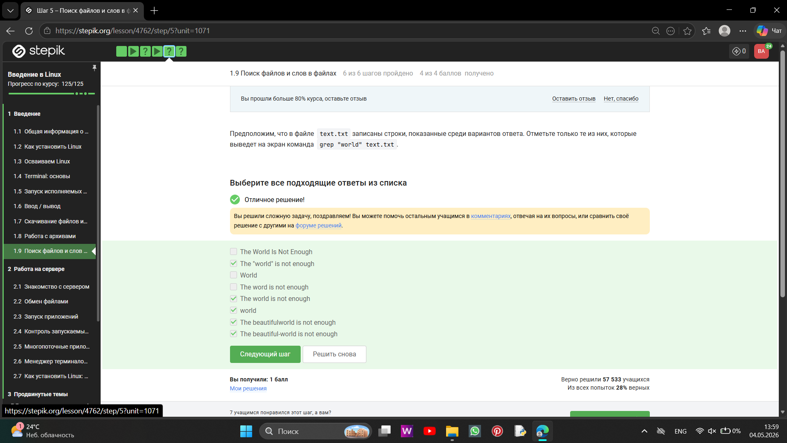

Не подходят 3 варианта, они не подходят потому что The World Is Not Enough - заглавная W, без -i не найдёт, World - заглавная W, The word is not enough - word, а не world.

29) Cкачайте архив с произведениями Шекспира. Вам нужно сгенерировать файл, в котором будут все строчки из этих произведений, содержащие “love”, и загрузить этот файл в форму.

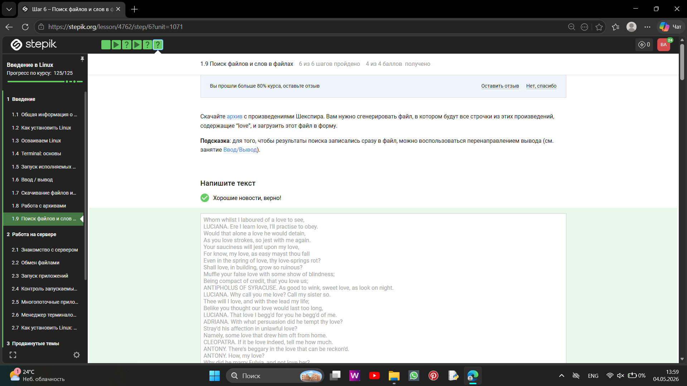

 скачала файл и сгенерироала файл, в котором получила такой список: 
 Whom whilst I laboured of a love to see,
LUCIANA. Ere I learn love, I'll practise to obey.
Would that alone a love he would detain,
As you love strokes, so jest with me again.
Your sauciness will jest upon my love,
For know, my love, as easy mayst thou fall
Even in the spring of love, thy love-springs rot?
Shall love, in building, grow so ruinous?
Muffle your false love with some show of blindness;
Being compact of credit, that you love us;
ANTIPHOLUS OF SYRACUSE. As good to wink, sweet love, as look on night.
LUCIANA. Why call you me love? Call my sister so.
Thee will I love, and with thee lead my life;
Belike you thought our love would last too long,
LUCIANA. That love I begg'd for you he begg'd of me.
ADRIANA. With what persuasion did he tempt thy love?
Stray'd his affection in unlawful love?
Namely, some love that drew him oft from home.
CLEOPATRA. If it be love indeed, tell me how much.
ANTONY. There's beggary in the love that can be reckon'd.
ANTONY. How, my love?
Why did he marry Fulvia, and not love her?
Now for the love of Love and her soft hours,
SOOTHSAYER. You shall be more beloving than beloved.
CHARMIAN. O, excellent! I love long life better than figs.
finest part of pure love. We cannot call her winds and waters
Whose love is never link'd to the deserver
CHARMIAN. Madam, methinks, if you did love him dearly,
Are newly grown to love. The condemn'd Pompey,
CLEOPATRA. O most false love!
So Antony loves.
And give true evidence to his love, which stands
And the ebb'd man, ne'er lov'd till ne'er worth love,
Ever love Caesar so?
The people love me, and the sea is mine;
Of both is flatter'd; but he neither loves,
Looking for Antony. But all the charms of love,
ENOBARBUS. Or, if you borrow one another's love for the instant,
Where now half tales be truths. Her love to both
Would each to other, and all loves to both,
The heart of brothers govern in our loves
Did ever love so dearly. Let her live
Fly off our loves again!
The winds were love-sick with them; the oars were silver,
Of us that trade in love.
than the love of the parties.
ENOBARBUS. A very fine one. O, how he loves Caesar!
ENOBARBUS. But he loves Caesar best. Yet he loves Antony.
His love to Antony. But as for Caesar,
AGRIPPA. Both he loves.
Betwixt us as the cement of our love
ANTONY. The April's in her eyes. It is love's spring,
I'll wrestle with you in my strength of love.
Let your best love draw to that point which seeks
Can never be so equal that your love
The ostentation of our love, which left unshown
Of us and those that love you. Best of comfort,
Each heart in Rome does love and pity you;
As you did love, but as you fear'd him.
I'll make death love me; for I will contend
More tight at this than thou. Dispatch. O love,
To business that we love we rise betime,
CLEOPATRA. Why is my lord enrag'd against his love?
As to a lover's bed. Come, then; and, Eros,
ANTONY. Let him that loves me, strike me dead.
Than love that's hir'd! What, goest thou back? Thou shalt
Which my love makes religion to obey,
The stroke of death is as a lover's pinch,
As needful in our loves, fitting our duty?
And with no less nobility of love
Ham. For God's love let me hear!
I will requite your loves. So, fare you well.
Ham. Your loves, as mine to you. Farewell.
Grows wide withal. Perhaps he loves you now,
Whereof he is the head. Then if he says he loves you,
Oph. My lord, he hath importun'd me with love
If thou didst ever thy dear father love-
As meditation or the thoughts of love,
From me, whose love was of that dignity
With all my love I do commend me to you;
May do t' express his love and friending to you,
Pol. Mad for thy love?
This is the very ecstasy of love,
More grief to hide than hate to utter love.
But never doubt I love.
reckon my groans; but that I love thee best, O most best, believe
Receiv'd his love?
When I had seen this hot love on the wing
Or look'd upon this love with idle sight?
Mark the encounter. If he love her not,
for love- very near this. I'll speak to him again.- What do you
obligation of our ever-preserved love, and by what more dear a
Ham. [aside] Nay then, I have an eye of you.- If you love me, hold
target; the lover shall not sigh gratis; the humorous man shall
The which he loved passing well.'
love passing well.
If't be th' affliction of his love, or no,
The pangs of despis'd love, the law's delay,
but now the time gives it proof. I did love you once.
inoculate our old stock but we shall relish of it. I loved you
Sprung from neglected love.- How now, Ophelia?
his love.
Ham. As woman's love.
Since love our hearts, and Hymen did our hands,
Make us again count o'er ere love be done!
For women's fear and love holds quantity,
Now what my love is, proof hath made you know;
And as my love is siz'd, my fear is so.
Where love is great, the littlest doubts are fear;
Where little fears grow great, great love grows there.
King. Faith, I must leave thee, love, and shortly too;
Such love must needs be treason in my breast.
Are base respects of thrift, but none of love.
That even our loves should with our fortunes change;
Whether love lead fortune, or else fortune love.
And hitherto doth love on fortune tend,
Ham. I could interpret between you and your love, if I could see
shall see anon how the murtherer gets the love of Gonzago's wife.
Ros. My lord, you once did love me.
Guil. O my lord, if my duty be too bold, my love is too unmannerly.
From the fair forehead of an innocent love,
You cannot call it love; for at your age
Stew'd in corruption, honeying and making love
Would gambol from. Mother, for love of grace,
This mad young man. But so much was our love
And, England, if my love thou hold'st at aught,-
How should I your true-love know
With true-love showers.
Nature is fine in love, and where 'tis fine,
After the thing it loves.
Oph. There's rosemary, that's for remembrance. Pray you, love,
Is the great love the general gender bear him,
I lov'd your father, and we love ourself,
King. Not that I think you did not love your father;
But that I know love is begun by time,
There lives within the very flame of love
In youth when I did love, did love,
Could not (with all their quantity of love)
Queen. For love of God, forbear him!
As love between them like the palm might flourish,
Ham. Why, man, they did make love to this employment!
I do receive your offer'd love like love,
O that you were your self, but love you are
O none but unthrifts, dear my love you know,
And all in war with Time for love of you,
Thou art more lovely and more temperate:
O carve not with thy hours my love's fair brow,
My love shall in my verse ever live young.
Mine be thy love and thy love's use their treasure.
Of his self-love to stop posterity?
Calls back the lovely April of her prime,
Unthrifty loveliness why dost thou spend,
The lovely gaze where every eye doth dwell
No love toward others in that bosom sits
For shame deny that thou bear'st love to any
Grant if thou wilt, thou art beloved of many,
Shall hate be fairer lodged than gentle love?
Make thee another self for love of me,

# Выполнение 2 этапа

1) Для каких задач можно использовать удаленный сервер? 

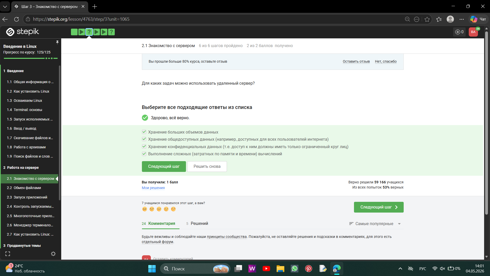

1. Хранение больших объемов данных — на сервере много места, которое можно расширять
2. Хранение общедоступных данных — сервер можно настроить для открытого доступа через интернет.
3. Хранение конфиденциальных данных — можно ограничить доступ паролями, ключами, VPN
4. Выполнение сложных вычислений — сервер обладает мощным процессором, памятью и работает без остановки.

2)Предположим программа ssh-keygen создала вам два ключа: id_rsa и id_rsa.pub. Какой из этих ключей можно без опаски пересылать по интернету? 

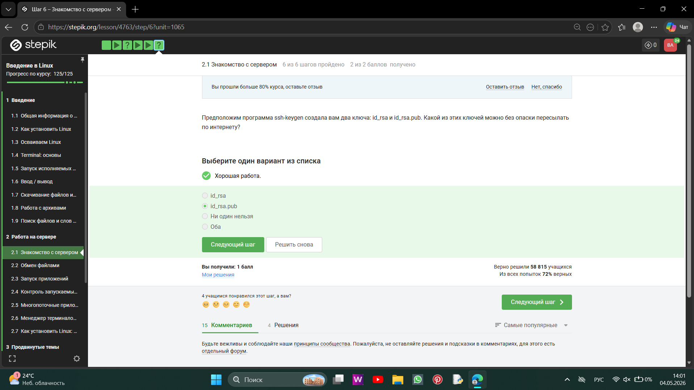

id_rsa.pub- Это открытый ключ. Он специально предназначен для распространения - его можно класть на серверы, передавать коллегам, публиковать. Зная открытый ключ, невозможно восстановить закрытый или взломать соединение.
id_rsa - закрытый ключ, его нельзя никому передавать и хранить нужно в секрете.

3)Какая команда скопирует на сервер (в домашнюю директорию) папку stepic вместе с содержимым ее самой и всех ее подпапок?

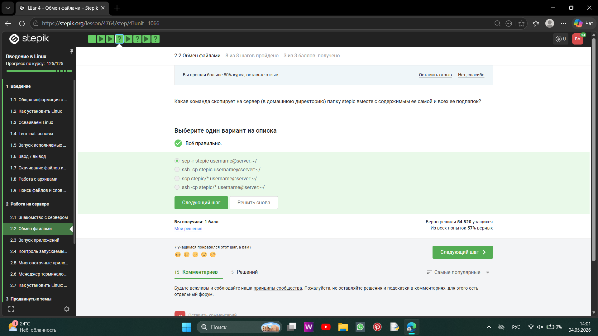

· scp — команда для копирования по SSH (в отличие от ssh)
· -r (recursive) — копирует папку со всем содержимым и подпапками
· stepic — имя папки
· username@server:~/ — удаленный сервер и домашняя директория
Остальные варианты неверны, так как используют ssh вместо scp либо копируют только содержимое (stepic/*), а не саму папку.

4)Предположим, что вы устанавливаете программу program на свой компьютер при помощи команды sudo apt-get install program. Терминал сообщает вам, что он не может найти и скачать установочный пакет. Какие действия могут устранить проблему? 

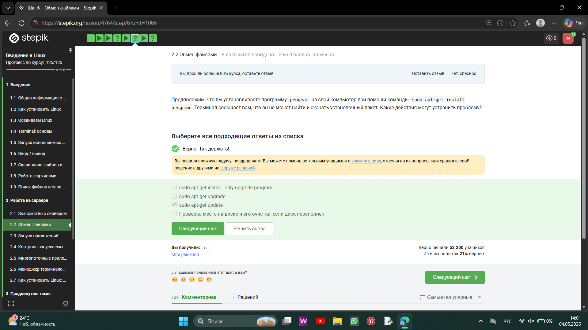

sudo apt-get update
sudo apt-get update: Эта команда обновляет локальный список доступных пакетов из репозиториев. Если список устарел, система просто не знает о существовании нужной версии программы — после update она сможет найти и скачать пакет

5)Для чего можно использовать программу Filezilla? 

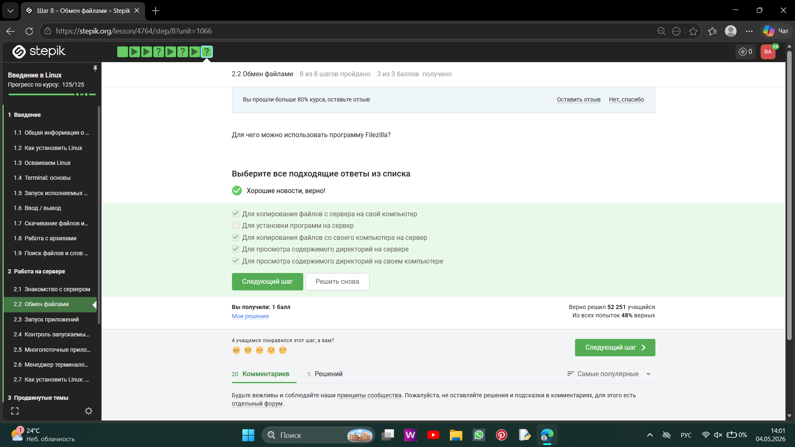

Filezilla — это FTP/SFTP-клиент для работы с файлами по сети. Она позволяет:

1. Копировать файлы с сервера на компьютер (скачивать)
2. Копировать файлы с компьютера на сервер (загружать)
3. Просматривать содержимое директорий на сервере (в удаленной панели)
4. Просматривать содержимое директорий на своем компьютере (в локальной панели)
Не подходит «Для установки программ на сервер», потому что установка программ требует выполнения команд (например, apt, yum) или запуска инсталляторов через терминал. Filezilla только передает файлы, но не запускает их установку на сервере.

6)Что можно сделать, если требуется запустить на сервере программу, для работы которой нужен не терминал, а экран? 

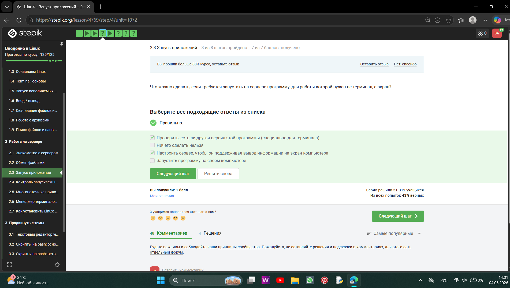

1. «Проверить, есть ли другая версия программы (специально для терминала)- Многие программы имеют CLI‑версию (command-line interface), которая делает то же самое, но работает без графического экрана. Это самое простое решение.
2. «Настроить сервер, чтобы он поддерживал вывод информации на экран компьютера»- Это возможно через X11 Forwarding (проброс графики по SSH). Сервер отправляет картинку интерфейса на ваш компьютер, и вы видите окно программы локально, хотя программа выполняется на сервере.

7)Как обычно можно вызвать справочную информацию о программе program? 

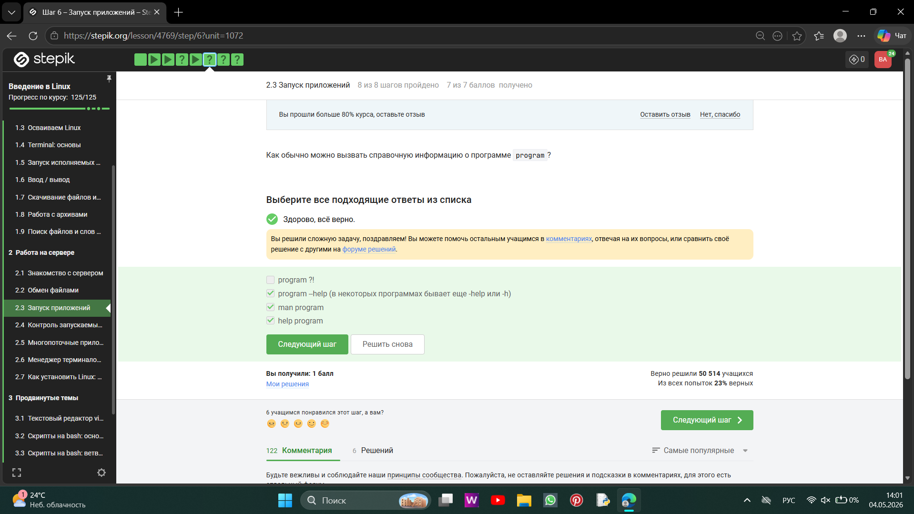

1. program --help (или -h, -help) — стандартный короткий флаг, который большинство программ поддерживают для вывода краткой справки по использованию.
2. man program — универсальная команда Linux, открывающая полноценное руководство (manual page) с детальным описанием всех опций.
3. help program — встроенная команда оболочки (shell) для получения справки о встроенных командах (например, help cd).
program ?! — такого стандартного соглашения в Linux/Unix нет, этот вариант не сработает.

8)Посмотрите справку по программе FastQC (имеется ввиду вариант для запуска в терминале) и определите, какие форматы данных он может принимать на вход. 

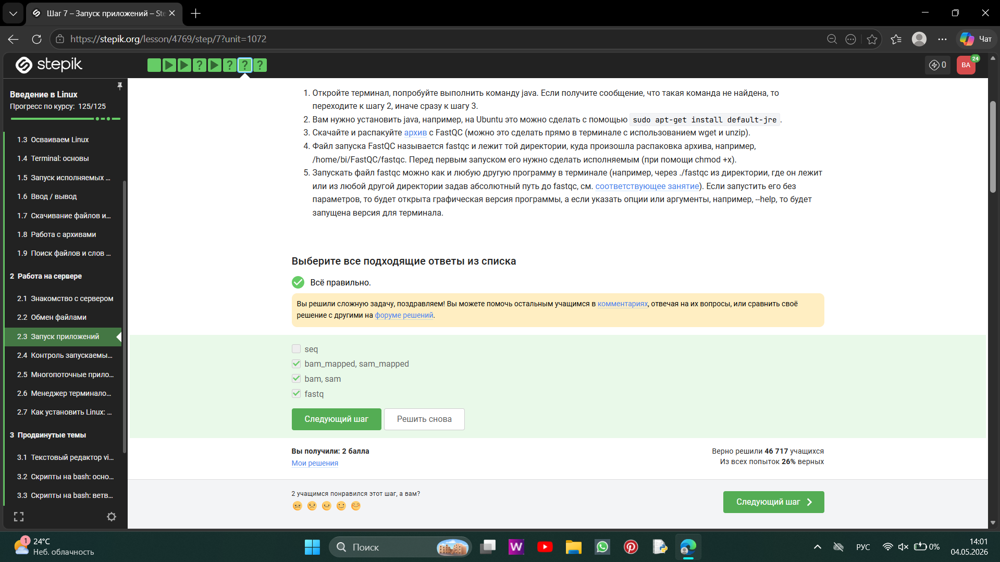

Это указано в справке программы (--help). Инструмент анализирует как сырые риды (fastq), так и выравненные последовательности (bam/sam), включая только успешно выровненные риды (bam_mapped/sam_mapped).

9)Посмотрите справку по программе (имеется в виду версия для терминала) и впишите в поле ниже команду, которая запускает в терминале Clustal на файле test.fasta и выполняет множественное выравнивание (multiple alignment). 

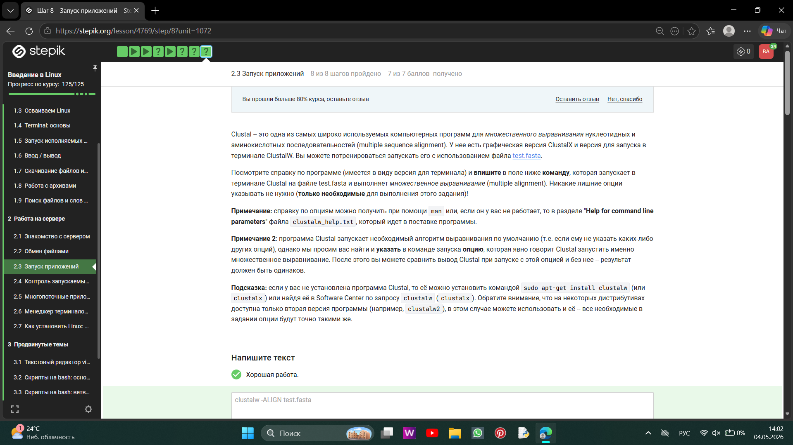

Я посмотрела справку по программе, ответом является clustalw -ALIGN test.fasta

10)Предположим вы запустили программы program1, program2 и program3 в фоновом режиме. После этого вы выполнили следующие действия: fg %1, Ctrl+С, fg %2, Ctrl+Z, jobs. Информация о каких программах будет показана при выполнении команды jobs? 

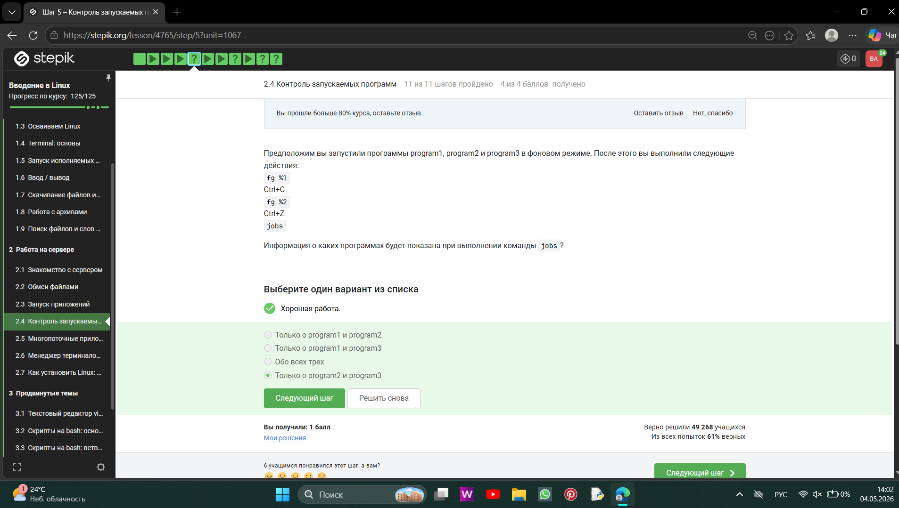

1. fg %1 — вернул program1 на передний план
2. Ctrl+C — завершил program1 (она перестала существовать)
3. fg %2 — вернул program2 на передний план
4. Ctrl+Z — приостановил program2 (осталась в фоне, но остановлена)
5. jobs — показывает только текущие фоновые задачи

11)jobs, top и ps позволяют отслеживать работу запущенных в терминале программ. В каждой из этих трех утилит для каждой запущенной программы указывается число-идентификатор. Одинаковые ли эти идентификаторы в  jobs, top и ps? 

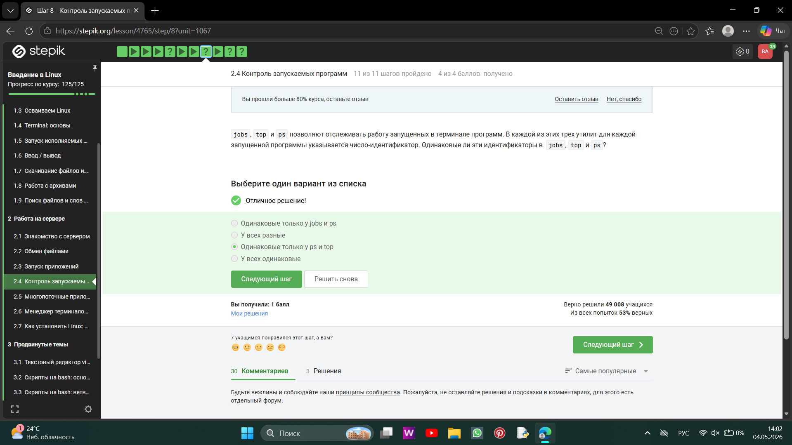

ps и top показывают PID (Process ID) — системный идентификатор процесса. Он одинаков для одной и той же программы в обеих утилитах.
· jobs показывает номер задачи (job ID: 1, 2, 3...) — это внутренний идентификатор текущей оболочки (shell), который не совпадает с PID.
Поэтому у jobs идентификаторы свои, а у ps и top — одинаковые (системные PID).

12)С помощью какой команды можно мгновенно завершить остановленный процесс? 

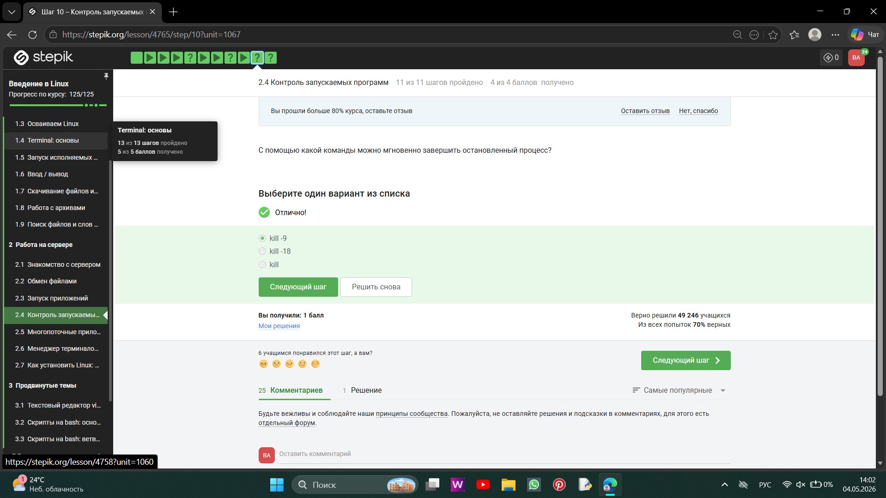

 kill -9 (SIGKILL) — мгновенно завершает процесс без возможности его перехватить, игнорировать или обработать. Остановленный (приостановленный) процесс завершается сразу.
· kill (без номера) — отправляет SIGTERM (15), процесс может игнорировать этот сигнал, что не гарантирует мгновенного завершения.
· kill -18 (SIGCONT) — наоборот, возобновляет остановленный процесс, а не завершает его.

13)Что произойдет, если использовать kill (без опций) по отношению к процессу, который был приостановлен при помощи Ctrl+Z? 

kill (без опций, т.е. SIGTERM) отправляет сигнал завершения, но процесс приостановлен (Ctrl+Z) и не принимает сигналы, пока не будет возобновлен. Когда процесс позже продолжат (например, fg или kill -18), он получит накопленный SIGTERM и начнет завершаться.

14)Сколько вычислительных ресурсов центрального процессора (% CPU) использует остановленное (по Ctrl+Z) многопоточное приложение? 

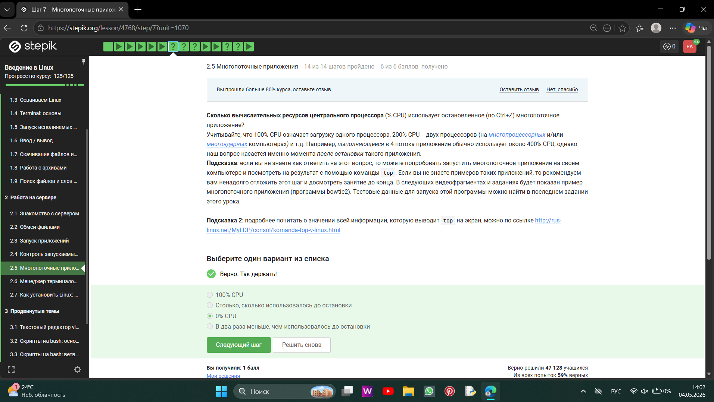

Остановленный процесс (SIGTSTP от Ctrl+Z) полностью исключается из планировщика задач — он не выполняет никаких инструкций и не потребляет процессорное время, поэтому его загрузка CPU равна 0%, независимо от того, сколько потоков у него было до остановки.

15)Сколько памяти занимает остановленное (по Ctrl+Z) многопоточное приложение? 

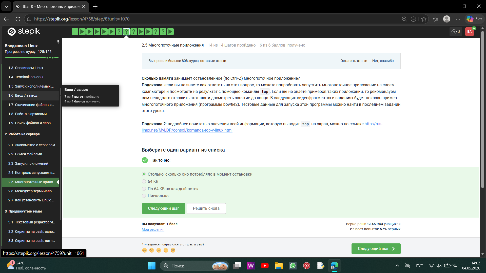

Остановка (Ctrl+Z) лишь приостанавливает выполнение инструкций процессором, но не освобождает выделенную процессу память (данные остаются в ОЗУ). Программа продолжает занимать те же страницы памяти, что и до остановки.

16)Как принудительно завершить один из потоков запущенного многопоточного приложения? 

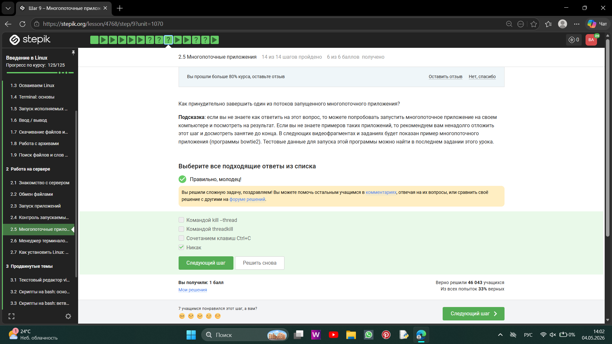

В стандартных Unix-подобных системах сигналы (включая kill) отправляются процессу целиком, а не отдельным потокам. Не существует штатной команды для принудительного завершения одного потока без остановки всего процесса. Потоки внутри процесса управляются ядром и самим приложением — извне выборочно "убить" один поток невозможно.

17)Для выполнения этого задания вам потребуется программа bowtie2.Изучите справочную информацию об этих подпрограммах (можно вызвать при помощи --help) и ответьте на вопрос -- какой(ие) из этих шагов можно выполнить в несколько потоков? 

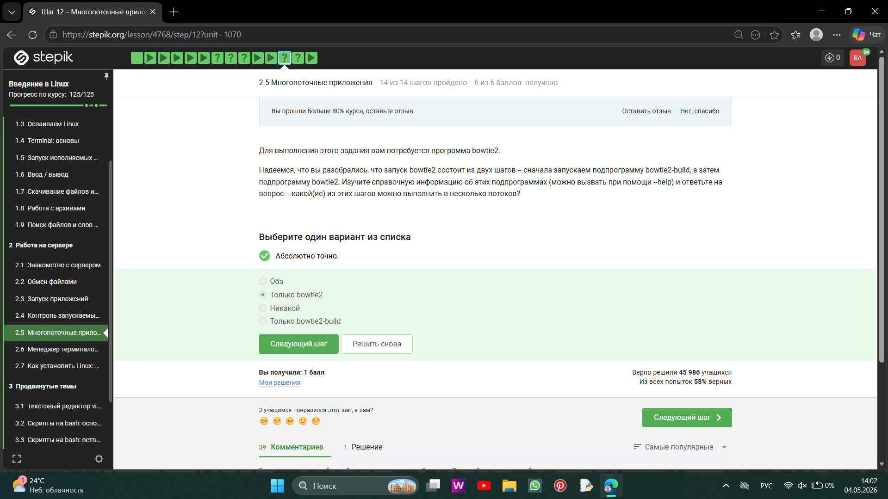

Согласно справочной информации, оба этапа поддерживают многопоточность, но ключевое различие в том, что только bowtie2 реально получает прирост производительности.
· bowtie2-build (--threads) — поддерживает многопоточность, но прирост от использования более 1 потока очень скромный
· bowtie2 (-p/--threads) — отлично масштабируется, использование нескольких потоков значительно ускоряет выравнивание (основную работу)
На практике большинство документаций рекомендуют первый шаг (индексацию) запускать в 1 поток , а второй (выравнивание) — в несколько. Поскольку вопрос предполагает практическую пользу от многопоточности, правильный ответ — только bowtie2.

18)Попробуйте теперь запустить второй этап (запуск подпрограммы bowtie2) в несколько потоков. Рекомендуем выставить число потоков равное количеству ядер на вашем компьютере (команда nproc). Сравните скорость выполнения в таком режиме с работой в один поток. Также рекомендуем убедиться, что результаты запусков (т.е. вывод в stderr) полностью совпали в обоих режимах! 

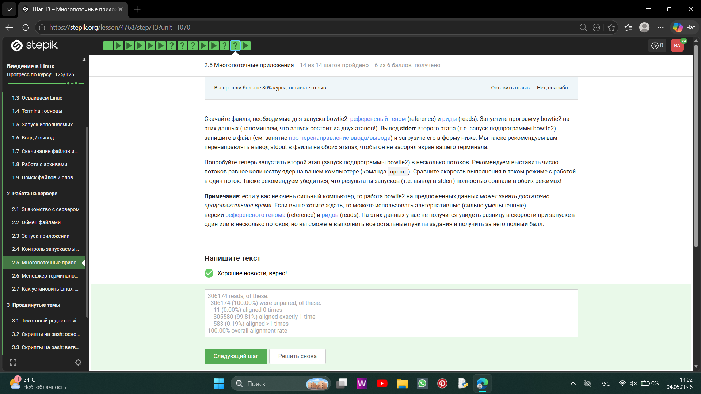

Попробовала запустить второй этап (запуск подпрограммы bowtie2) в несколько потоков, ответ: 306174 reads; of these:
  306174 (100.00%) were unpaired; of these:
    11 (0.00%) aligned 0 times
    305580 (99.81%) aligned exactly 1 time
    583 (0.19%) aligned >1 times
100.00% overall alignment rate

19)Вы открыли две вкладки в терминале. В одной из них вы запустили процесс и приостановили его. Переключившись во вторую вкладку и набрав fg, вы добьетесь следующего: 

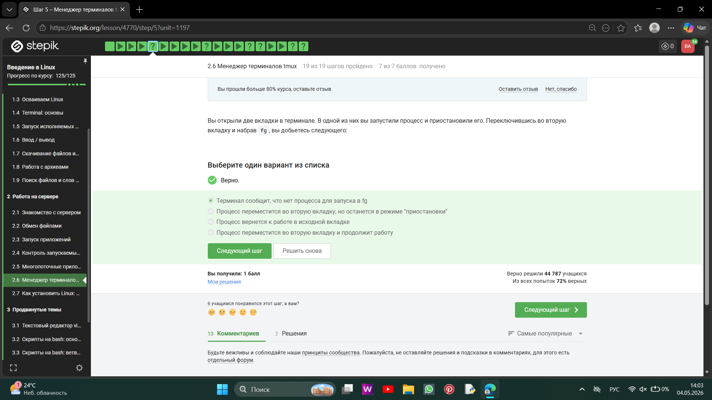

fg работает только в рамках текущей сессии оболочки (shell), в которой процесс был запущен и приостановлен. При переключении на другую вкладку вы оказываетесь в другом экземпляре оболочки, у которого своя таблица задач (jobs). Там нет никаких приостановленных процессов, поэтому fg не находит, что возвращать на передний план.

20)Предположим, что в tmux осталась последняя открытая вкладка. Что произойдет, если вы введете в этой вкладке в командную строку команду exit? 

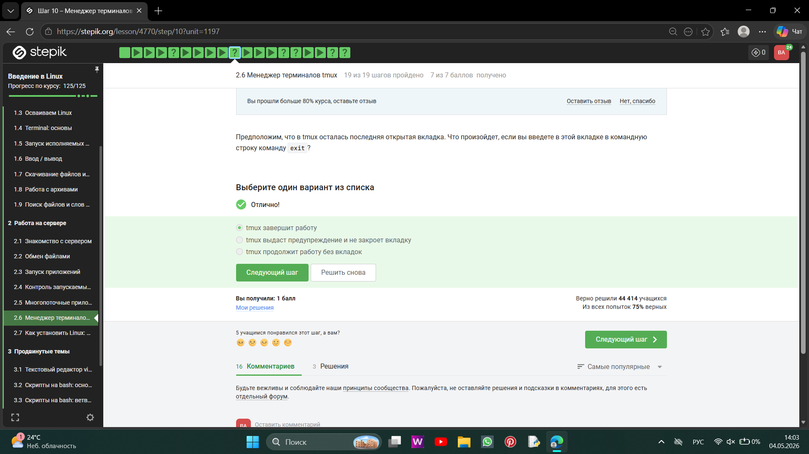

В tmux сессия существует, пока в ней есть хотя бы одно окно (вкладка). Когда вы вводите exit в последнем окне сессии, это окно закрывается, сессия остается без окон и автоматически завершается. Исключение — если сессия была отсоединена (detached), но в данном случае вы работаете в ней.

21)Предположим, что вы открыли терминал, зашли в нем на сервер, запустили на этом сервере tmux и начали работу в нем. Что произойдет, если вы теперь закроете терминал? 

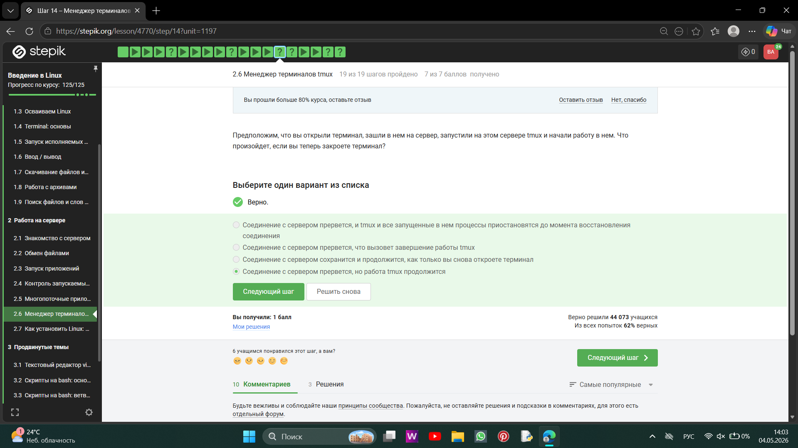

tmux работает на сервере независимо от вашего локального терминала. Когда вы закрываете терминал, SSH-соединение обрывается, но процессы на сервере (включая tmux и всё, что в нём запущено) продолжают выполняться. Позже вы можете снова подключиться к серверу и выполнить tmux attach, чтобы вернуться к той же сессии.

22)Что произойдет, если запустить процесс в фоновом режиме в одной из вкладок tmux, а затем принудительно закрыть эту вкладку (Ctrl+B, X)? 

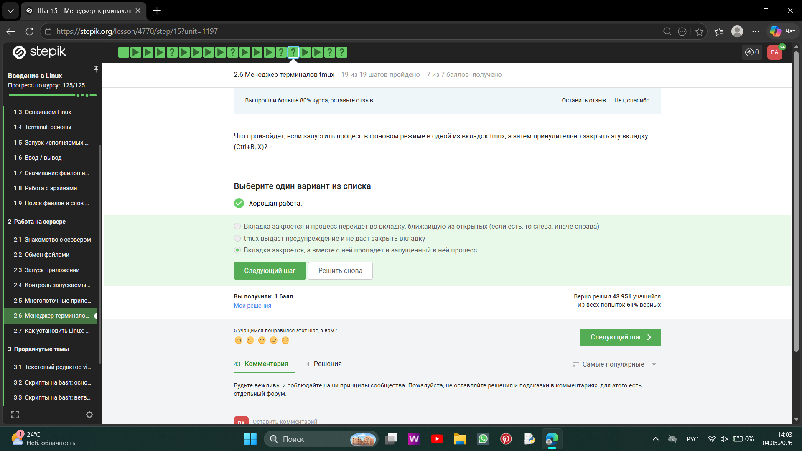

Когда в tmux закрывается окно (вкладка), все процессы, запущенные внутри него, получают сигнал SIGHUP и завершаются. Фоновый режим (&) не защищает от закрытия окна — процесс все равно привязан к сессии внутри этой вкладки. Если нужно сохранить процесс после закрытия окна, его следует запускать через nohup, disown или отдельной сессией tmux.

23)Задание на самостоятельное изучение tmux. Изучите справку по tmux (например, man tmux) и выберите из предложенных ниже tmux-команд ту, которая отвечает за переименование текущей вкладки.

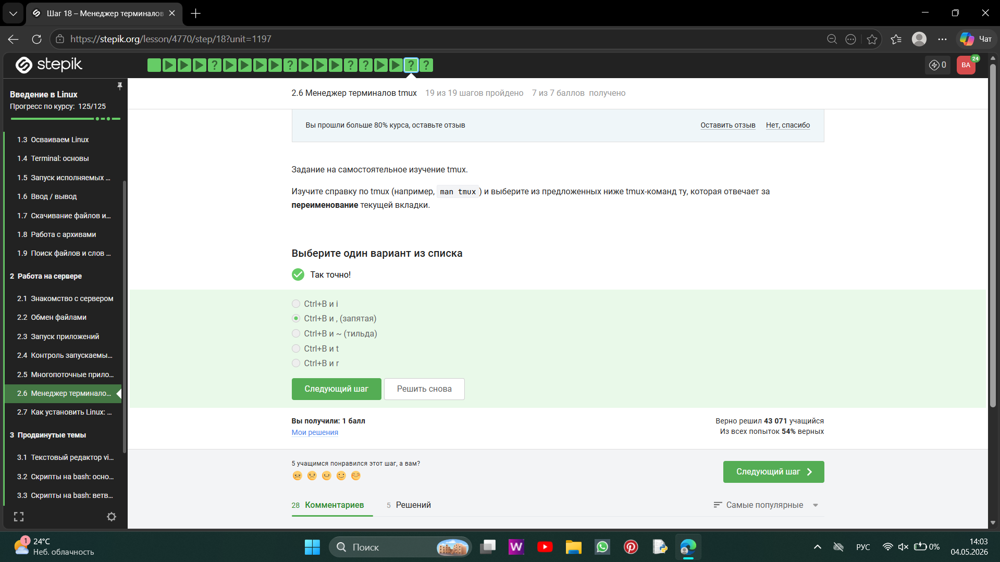

В tmux сочетание Ctrl+B , (Control + B, затем запятая) вызывает команду переименования текущего окна (вкладки). После этого внизу появится строка ввода, где можно изменить название вкладки. Остальные варианты делают другое:
· Ctrl+B i — информация о текущем окне
· Ctrl+B ~ — сообщения об ошибках/отладка
· Ctrl+B t — показать часы
· Ctrl+B r — перезагрузить конфигурацию

24)Предлагаем вам самостоятельное изучить работу с "вкладками внутри вкладок" и отметить верные утверждения из списка ниже. Вы можете использовать справку по tmux (например, man tmux) или просто попробовать воспроизвести эти утверждениях у себя на компьютере

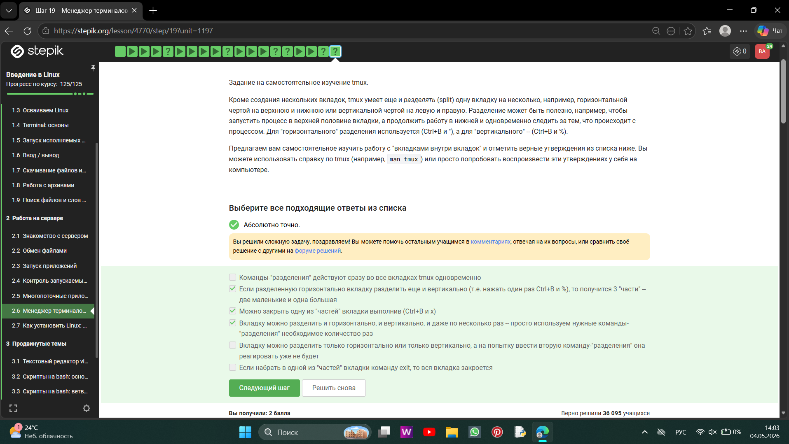

1. 3 части — при горизонтальном делении (верх/низ) и последующем вертикальном делении одной из половин (например, верха) получается левая, правая и целая нижняя панели.
2. Ctrl+B + x — закрывает только текущую панель (часть окна), остальные остаются.
3. Можно делить многократно — tmux позволяет дробить любую панель в произвольном порядке сколько угодно раз, создавая сложные раскладки.

# Выполнение 3 этапа

1) Какую клавишу(и) нужно нажать на клавиатуре, чтобы выйти из редактора vim? Считайте, что вы только что открыли файл и вам сразу понадобилось выйти из редактора. 

В vim нормальный режим (Normal mode) — это режим по умолчанию сразу после открытия файла. Чтобы выйти, нужно перейти в режим командной строки (Command-line mode) с помощью : (двоеточие), затем ввести команду q (quit) и подтвердить её клавишей Enter. Команда :q работает, если файл не был изменён. Если изменения были, потребуется :q!.

2) А для того, чтобы убедиться, что вы разобрались, отметьте ниже все верные утверждения про следующую строку:
Strange_TEXTis_here.2=2 YES! 

w делит строку на большее количество мелких частей (буквы, цифры, _ против пунктуации), а W — на крупные блоки, разделённые только пробелами. Поэтому для прохода всей строки клавишу W нужно нажать меньше раз, чем w

3) Предположим, что в текстовом файле записана одна единственная строка:
one two three four five
и вам нужно преобразовать её в строку
three four four four five
Какие(ой) из предложенных ниже наборов нажатий клавиш выполнят такое редактирование? В этих наборах нажатие на клавишу Esc обозначается как <Esc> (т.е. знаки "<" и ">" не несут отдельного смысла). 

· d2wwywpp неверен, потому даёт three three three four five (три «three»).
· Все остальные варианты (включая странные типа xxxxxxxxwywPp) либо дают нужную строку three four four four five, либо содержат команды, которые ничего не ломают (например, xxxxxxxx игнорируется), а последующие движения и вставки в итоге приводят к правильному результату. Поэтому тест засчитал их как верные.

4) Какую команду нужно ввести для этого в vim? Укажите необходимую команду целиком (т.е. включая ввод ":" в самом начале), однако нажатие на Enter после ввода команды обозначать никак не нужно. 

Правильная команда: :%s/Windows/Linux/
· % — применить ко всем строкам файла.
· s/Windows/Linux/ — заменить первое вхождение Windows в каждой строке на Linux.
· Отсутствие флага g означает замену только первого слова в строке, что соответствует условию.

5) Чтобы убедиться, что вы разобрались с этим режимом работы, отметьте, пожалуйста, все верные утверждения из списка ниже. 

Из утверждения «Режим выделения открывается из любого другого режима по нажатию "v"» неверно, потому что v работает только из нормального режима. Из режима вставки или командной строки нужно сначала нажать Esc. Остальное всё верно

6) Предположим, что вы открыли терминал и у вас в нем запущена оболочка bash. Вы набираете в ней команды А1, А2, А3, а затем запускаете оболочку sh. В этой оболочке вы набираете команды B1, В2, В3 и запускаете оболочку bash. И, наконец, в этой последней оболочке вы набираете команды С1, С2, С3. Если теперь вы попробуете при помощи стрелочек вверх/вниз перемещаться по истории набранных команд, то команды из какого набора(ов) будут появляться? 

История команд (стрелочки вверх/вниз) хранится в текущей оболочке и не наследуется дочерними оболочками.
· Вы запустили bash следовательно набор А в истории этой оболочки.
· Запустили sh (дочерняя оболочка) значит у неё своя пустая история, команды В записываются в неё.
· Запустили bash (ещё одна дочерняя) значит у неё своя пустая история, команды С записываются в неё.
Когда вы нажимаете стрелочки в последнем bash, видите только С, потому что история родительских оболочек (А и В) недоступна.

7) Вы можете скачать и изучить скрипты, которые мы показали в видеофрагменте: script1.sh, script2.sh.

Предположим, что вы находитесь в директории /home/bi/Documents/ и запускаете в ней скрипт. Как будет выглядеть абсолютный путь до созданного файла file1.txt по окончанию работы скрипта? 

1. cd /home/bi/ — переход в директорию /home/bi/
2. touch file1.txt — создание файла file1.txt в текущей директории, которой теперь является /home/bi/
3. cd /home/bi/Desktop/ — переход в другую директорию, но файл уже создан в /home/bi/
Таким образом, абсолютный путь к созданному файлу — /home/bi/file1.txt. Последняя смена директории не перемещает уже созданный файл.

8) Какие из представленных ниже строк могут быть именами переменных в bash? Выберите все подходящие варианты! 

Почему подходят:
· __variable — можно (начинается с _, дальше буквы и _)
· _variable — можно (начинается с _)
· variable_123 — можно (буквы, цифры и _)
· variable123 — можно (буквы и цифры)
Почему остальные не подходят:
· var-i-able — дефис - не разрешён (воспринимается как вычитание)
· var.i.able — точка . не разрешена
· variab$$le — $ имеет специальное значение (подстановка переменной)

9) Напишите скрипт на bash, который принимает на вход два аргумента и выводит на экран строку следующего вида:Arguments are: $1=первый_аргумент $2=второй_аргумент 

1. #!/bin/bash — шебанг (shebang), указывает, что скрипт должен выполняться в оболочке bash.
2. var1=$1 — присваивает переменной var1 значение первого аргумента, переданного скрипту ($1).
3. var2=$2 — присваивает переменной var2 значение второго аргумента ($2).
4. echo "Arguments are: \$1=$var1 \$2=$var2" — выводит строку, где:
   · \$1 — экранированный доллар, выводится как символ $1 (не подстановка)
   · $var1 — подставляется значение переменной var1
   · \$2 — выводится как символ $2
   · $var2 — подставляется значение переменной var2
   
10) Предположим, вы пишете скрипт на bash и хотите использовать в нем конструкцию if в следующем фрагменте.
Вы можете вписать вместо "..." (внутри [[ ]] и не забудьте про пробелы после [[ и перед ]]!) любое из перечисленных ниже условий. Однако мы просим вас выбрать только те из них, при которых echo напечатает на экран True вне зависимости от того, с какими параметрами был запущен ваш скрипт и какие в нем есть переменные. 

1. $var1 == $var2 || $var1 != $var2 — логическая тавтология (закон исключённого третьего), всегда истинно.
2. $# -ge 0 — количество аргументов всегда ≥ 0 (ноль или больше), всегда истинно.
3. -n $0 — $0 (имя скрипта) всегда непустая строка, поэтому -n всегда истинно.
4. ! (4 -le 3) — 4 ≤ 3 — ложь, отрицание лжи → истина.

11)Посмотрите на фрагмент bash-скрипта. Какие строки и в какой последовательности он выведет на экран, если сначала этот скрипт запустили задав переменную var=3, а затем запустили еще раз, но уже с var=5. 

· При var=3:
  Проверяем условия по порядку:
  3 -gt 5? → нет
  3 -lt 3? → нет (равно, а не меньше)
  3 -eq 4? → нет
  Идём в else → выводим "four"
· При var=5:
  5 -gt 5? → нет (не больше, а равно)
  5 -lt 3? → нет
  5 -eq 4? → нет
  Идём в else → выводим "four"
  
12) Напишите скрипт на bash, который принимает на вход один аргумент (целое число от 0 до бесконечности), который будет обозначать число студентов в аудитории. В зависимости от значения числа нужно вывести разные сообщения. 
Соответствие входа и выхода должно быть таким:
0 -->  No students
1 -->  1 student
2 -->  2 students
3 -->  3 students
4 -->  4 students
5 и больше A lot of students
Примечание а): выводить нужно только строку справа, т.е. "-->" выводить не нужно.
Примечание б): в последней строке слово "lot" с маленькой буквы! 

Скрипт анализирует переданный аргумент $1 (количество студентов) и выводит:
· $1 student — если $1 равно 1
· $1 students — если $1 от 2 до 4 включительно
· A lot of students — если $1 ≥ 5
· No students — если $1 отрицательное или не число (иначе)

13) Вы можете скачать и изучить скрипты, которые мы показали в видеофрагменте: loops1.sh, loops2.sh.
Посмотрите на фрагмент bash-скрипта. Если запустить этот скрипт, то сколько раз на экран будет выведено слово "start", а сколько раз слово "finish"? 

Цикл перебирает 5 элементов: a , , , b , , , c_d
· "start" печатается 5 раз (на каждый элемент)
· "finish" печатается 4 раза (только для первых четырёх, так как для c_d срабатывает continue)

14) Напишите скрипт на bash, который будет определять в какую возрастную группу попадают пользователи. При запуске скрипт должен вывести сообщение "enter your name:" и ждать от пользователя ввода имени (используйте read, чтобы прочитать его). Когда имя введено, то скрипт должен написать "enter your age:" и ждать ввода возраста (опять нужен read). Когда возраст введен, скрипт пишет на экран "<Имя>, your group is <группа>", где <группа> определяется на основе возраста по следующим правилам:
    младше либо равно 16: "child",
    от 17 до 25 (включительно): "youth",
    старше 25: "adult".
После этого скрипт опять выводит сообщение "enter your name:" и всё начинается по новой (бесконечный цикл!). Если в какой-то момент работы скрипта будет введено пустое имя или возраст 0, то скрипт должен написать на экран "bye" и закончить свою работу (выход из цикла!) 

1. Запрашивает имя.
   · Если имя пустое или 0 → выводит bye и завершает работу.
2. Если имя введено → переходит к запросу возраста.
   · Возраст 0 или пустой → bye и выход.
3. В зависимости от возраста выводит группу:
   · ≤ 16 → child
   · ≥ 17 и ≤ 25 → youth (отдельная проверка внутри else)
   · > 25 → adult
   
15) Какие(ая) из предложенных ниже инструкций увеличат значение переменной а на значение переменной b? Например, если в а было записано 10, в b было 5, то в а должно записаться 15. 

1. "let a=$a+$b" — let выполняет арифметику, подставляются значения переменных, результат присваивается a.
2. "let "a = a + b"" — кавычки позволяют использовать пробелы, let складывает значения a и b, результат в a.
3. "let "a+=b"" — сокращённая форма a = a + b, работает корректно.
Почему остальные не подходят:
· "a+=$b" — в bash это конкатенация строк (не сложение чисел), если a=10, b=5, то a станет 105.
· "let "a=+b"" — это присваивание a = b (с унарным плюсом), а не сложение.
· "let a=$a+$b" — работает (входит в верные), но в списке он написан с разрывами: "let a= $a+ $b" — из‑за пробелов после = и перед + будет синтаксическая ошибка.

16) Пусть вы находитесь в директории /home/bi/Documents/ и запускаете в ней скрипт следующего содержания.
Что в этом случае выведет команда echo на экран? 

Внутри скрипта сначала выполняется cd /home/bi/ — текущая директория меняется на /home/bi/. Затем команда echo "pwd" использует обратные кавычки (или $()), которые подставляют результат выполнения команды pwd. pwd выводит путь к текущей директории, а она теперь равна /home/bi/. Поэтому echo выводит /home/bi.

17) Однако как быть, если хочется всё-таки запустить программу program, которая пишет что-то в stdout, и потом выполнить какие-то действия, если её код возврата равен 0? Выберите все верные утверждения или правильно работающие конструкции if 

- Сначала запустить program, затем if [[ $? -eq 0 ]]
  - $? хранит код возврата последней выполненной команды.
  - Вывод program в stdout при этом игнорируется (или может быть перенаправлен), а проверяется именно код возврата.
- if program > some_file.txt
  - Перенаправление stdout в файл убирает вывод из проверяемой подстановки.
  - if смотрит на код возврата program, а не на то, что попало в файл.
  - Условие сработает, если код возврата = 0.

Почему остальные не подходят:
- if [[ $(program) -eq 0 ]] — в условие подставится вывод program, а не код возврата. Если программа выводит текст, это вызовет ошибку.
- var=$(program); if [[ $var -eq 0 ]] — аналогично, var получает вывод, а не код.
- «Ничего сделать нельзя» — неверно, варианты выше работают.

18) Посмотрите на функцию из bash-скрипта.
Впишите в форму ниже строку, которую выведет на экран команда echo "counters are $c1 and $c2" если она находится в скрипте после десяти вызовов функции counter с параметрами сначала 1, затем 2, затем 3 и т.д., последний вызов с параметром 10. 

c1 объявлена как local → живёт только внутри функции, глобальное значение c1 остаётся 0.
c2 глобальная → накапливает сумму: 2*(1+2+...+10) = 110.

19) Напишите скрипт на bash, который будет искать наибольший общий делитель (НОД, greatest common divisor, GCD) двух чисел. При запуске ваш скрипт не должен ничего писать на экран, а просто ждет ввода двух натуральных чисел через пробел (для этого можно использовать read и указать ему две переменные -- см. пример в видеофрагменте). После ввода чисел скрипт считает их НОД и выводит на экран сообщение "GCD is <посчитанное значение>", например, для чисел 15 и 25 это будет "GCD is 5". После этого скрипт опять входит в режим ожидания двух натуральных чисел. Если в какой-то момент работы пользователь ввел вместо этого пустую строку, то нужно написать на экран "bye" и закончить свою работу. 

Скрипт в цикле читает два числа n1 и n2.
Если первое число пустое → bye и выход.
Функция gcd:
Проверяет n2 (внутренний, не глобальный) на ноль — если ноль, выводит bye.
Алгоритм Евклида: пока остаток не ноль — вычисляет n1 % n2, обновляет n1 и n2.
После вызова функции выводится "GCD is $n1" (глобальный n1 не менялся функцией, так как внутри функции используются свои локальные переменные из аргументов).

20) Напишите калькулятор на bash. При запуске ваш скрипт должен ожидать ввода пользователем команды (при этом на экран выводить ничего не нужно). Команды могут быть трех типов: 
    Слово "exit". В этом случае скрипт должен вывести на экран слово "bye" и завершить работу. 
    Три аргумента через пробел -- первый операнд (целое число), операция (одна из "+", "-", "*", "/", "%", "**") и второй операнд (целое число). В этом случае нужно произвести указанную операцию над заданными числами и вывести результат на экран. После этого переходим в режим ожидания новой команды.
    Любая другая команда из одного аргумента или из трех аргументов, но с операцией не из списка. В этом случае нужно вывести на экран слово "error" и завершить работу.
Чтобы проверить работу скрипта, вы можете записать сразу несколько команд в файл и передать его скрипту на stdin (т.е. выполнить ./script.sh < input.txt). В этом случае он должен вывести сразу все ответы на экран 

1. Читает три слова: birinchi, amal, ikkinchi
2. Если birinchi == "exit" → выводит "bye" и выходит
3. Если birinchi и ikkinchi оба являются числами (по регулярному выражению) → выводит "error" и выходит (логика странная)
4. Иначе выполняет операцию (amal) между числами (birinchi и ikkinchi) через case:
   · +, -, /, *, %, ** — арифметические действия
   · * и ** нужно экранировать при вводе
5. Выводит результат и повторяет цикл

21)Пусть в директории /home/bi лежат файлы Star_Wars.avi, star_trek_OST.mp3, STARS.txt, stardust.mpeg, Eddard_Stark_biography.txt. Отметьте все файлы, которые найдет команда find /home/bi -iname "star*", но НЕ найдет команда find /home/bi -name "star*"? 

-name "star*" — ищет файлы, начинающиеся ровно с star (регистр важен) → найдёт только stardust.mpeg и star_trek_OST.mp3 (если они начинаются с star в нижнем регистре).
· -iname "star*" — ищет без учёта регистра → найдёт также STARS.txt (начинается с STARS) и Star_Wars.avi (начинается с Star).
· Eddard_Stark_biography.txt не начинается с star/Star/STAR в любом регистре → не подходит.

22) Задание на понимание работы опций -path и -name команды find. Отметьте все верные утверждения из перечисленных ниже. 

1. -name найдёт больше — если шаблон (например "f*") есть в имени файла, но не в полном пути, а -path его не найдёт, потому что путь не соответствует.
2. -name найдёт меньше — если шаблон соответствует части пути, но не совпадает с именем файла. Пример: ищем "dir" — файл с именем dir.txt не подойдёт, а путь ./my_dir/file подойдёт для -path.
3. Результат может быть одинаковым — если файлы лежат прямо в искомой директории, и шаблон совпадает и с именем, и с путём (например, "file.txt"). Тогда замена -name на -path ничего не меняет.
Остальные неверны:
· -path не игнорирует регистр (для этого есть -ipath).
· -path ищет по полному пути, а -name — только по имени файла, оба могут искать и файлы, и директории.

23) Предположим, что в директории /home/bi/ есть следующая структура файлов и поддиректорий. Какие(ой) из трех файлов (file1, file2, file3) будут найдены по команде find /home/bi -mindepth 2 -maxdepth 3 -name "file*"? 

Команда: find /home/bi -mindepth 2 -maxdepth 3 -name "file*"
· -mindepth 2 — начинаем поиск с уровня глубины 2 (относительно /home/bi).
· -maxdepth 3 — не глубже уровня 3.
Определим глубину каждого файла:
· /home/bi/dir1/file1 — глубина 2
· /home/bi/dir1/dir2/file2 — глубина 3
· /home/bi/dir1/dir2/dir3/file3 — глубина 4
file3 имеет глубину 4, что превышает -maxdepth 3, поэтому он не будет найден. Остальные два — попадают в диапазон.

24) Задание на понимание работы опций -A, -B и -C команды grep. Пусть у вас есть файл file.txt из 10 строк, причем в каждой строке есть слово "word". Если вы выполните на этом файле команды:
grep "word" file.txt > results.txt
grep -A 1 "word" file.txt > results.txt
grep -B 1 "word" file.txt > results.txt
grep -C 1 "word" file.txt > results.txt
то какая(ие) из них создаст файл
results.txt наибольшего размера? 

Файл состоит из 10 строк, и каждая строка содержит слово "word".
· grep "word" — найдет все 10 строк.
· grep -A 1 — найдет каждую строку + 1 строку после. Но так как "word" есть в каждой строке, а следующая строка тоже содержит "word" (и тоже будет выведена как часть совпадения), суммарно всё равно будут выведены все 10 строк (без дублирования).
· grep -B 1 — аналогично, каждая строка + 1 строка до → опять все 10 строк.
· grep -C 1 — каждая строка + 1 до + 1 после → всё те же 10 строк.
Во всех случаях выводится один и тот же набор строк (весь файл), поэтому размер results.txt одинаков.

25) Предположим, что в файле  text.txt записаны строки, показанные среди вариантов ответа. Отметьте только те из них, которые выведет на экран команда  grep -E "[xklXKL]?[uU]buntu$" text.txt. 

Регулярна [xklXKL]?[uU]buntu$ ищет в конце строки:
· ubuntu или Ubuntu
· с возможным одним символом перед ними из набора x,k,l,X,K,L.
Подходят:
· Hmm, XKLubuntu (в конце XKLubuntu, L из набора перед ubuntu)
· I prefer Kubuntu (в конце Kubuntu, K из набора перед ubuntu)
Остальные либо не заканчиваются на buntu, либо неправильный символ перед ним (Uuuubuntu! — U не входит в набор).

26) Что произойдет, если в команде sed -n "/[a-z]*/p" text.txt не указывать опцию -n?

 Без -n sed по умолчанию печатает каждую строку (как p в конце каждого цикла).
· Команда "/[a-z]*/p" говорит: дополнительно напечатать каждую строку, которая соответствует шаблону [a-z]* (а это любая строка, так как * означает "ноль или более" строчных букв).
· Итог: каждая строка печатается один раз автоматически + второй раз по команде p следовательно два раза.

27) Запишите в форму ниже инструкцию sed, которая заменит все "аббревиатуры" в файле input.txt на слово "abbreviation" и запишет результат в файл edited.txt (на экран при этом ничего выводить не нужно). Обратите внимание, что в инструкции должны быть указаны и сам sed, и оба файла! 

Команда sed -r 's/ [A-Z][A-Z]+ / abbreviation /g' input.txt > edited.txt
· Ищет пробел → две и более заглавные буквы → пробел
· Заменяет найденное на " abbreviation " (пробелы сохраняются)
· -r включает расширенные regex (чтобы + работал)
· > edited.txt сохраняет результат в файл, на экран ничего не выводит

28) Какую опцию нужно указать при запуске gnuplot, чтобы при его закрытии не были автоматически закрыты и все нарисованные в нём графики? 

Опция --persist (или -p) заставляет gnuplot не закрывать окна с графиками после выхода из программы. Без этой опции графики закрываются вместе с gnuplot.

29) Предположим у вас есть файл data.csv с двумя столбцами по 10 чисел в каждом. В первой строке не записаны названия столбцов, т.е. ряды данных начинаются прямо с первой строки. Вы запускаете gnuplot и вводите в него две команды:
set key autotitle columnhead
plot 'data.csv' using 1:2
Какое в этом случае будет название у построенного ряда данных и сколько будет нарисовано точек на графике? 

1. set key autotitle columnhead — gnuplot берёт название ряда из первой строки указанного столбца. В данном случае из второго столбца (using 1:2).
2. Первая строка используется как заголовок → она не рисуется как точка.
3. Всего строк 10. Одна уходит на заголовок → остаётся 9 точек для построения графика.

30) Предположим, что вы пишите gnuplot-скрипт и у вас в нем есть три переменные x1, x2, x3, в которых записаны координаты важных точек по оси ОХ (по возрастанию). Вы хотите, чтобы на этой оси было только три деления (т.е. три черточки) в этих самых координатах, а подписи этих делений были оформлены в виде "point <номер точки>, value <значение соответствующей переменной>". 

· set xtics — задаёт положение и подписи делений на оси X.
· В скобках перечисляются пары "подпись" положение.
· С помощью конкатенации (через точку .) склеиваем текст "point 1, value " со значением переменной x1.
· После запятой указываем координату x1 — где поставить деление.
· Аналогично для x2, x3.

31) Указанные файлы использовались в последнем видеофрагменте для создания вращающегося графика. Измените инструкции в файле move.rot (т.е. добавлять и удалять инструкции нельзя!) таким образом, чтобы:
    График отразился зеркально относительно горизонтальной поверхности. То есть там, где была точка (10, 10, 200), станет точка (10, 10, -200), где была точка  (-10, -10, 200) станет (-10, -10, -200) и т.д. При этом точка (0, 0, 0) останется на месте.
    Изображение стало вращаться в обратную сторону. То есть если раньше вращалось "влево", то теперь станет "вправо".
    Вращение стало в два раза быстрее. То есть станет в два раза больше перерисовок графика на каждую секунду вращения. Измененный файл загрузите в форму ниже. 

· zrot=(zrot+20)%360 — скорость выше в 2 раза (20° вместо 10°), направление обратное
· splot x* *2+y* *2 — зеркальное отражение (смена знака Z)

32) Какая команда(ы) установят файлу file.txt права доступа rwxrw-r--, если изначально у него были права r--r--r--. Укажите все верные варианты ответа! 

Нужные права: rwx rw- r--
· Восьмерично: 764 (rwx=7, rw-=6, r--=4)
1. chmod 764 file.txt — напрямую задаёт нужные права.
2. chmod a+wx file.txt; chmod o-wx file.txt; chmod g-x file.txt
   · a+wx → добавляет w и x всем (rwxrwxrwx из r--r--r--)
   · o-wx → убирает w и x у остальных (rwxrwxr--)
   · g-x → убирает x у группы (rwxrw-r--) → готово.
Почему остальные неверны:
· chmod 777 → rwxrwxrwx (много лишнего)
· chmod 467 → r--rw-rwx (не те права)
· chmod o-wx; chmod g-x; chmod a+wx — порядок другой, итог может отличаться.

33) Предположим вы использовали команду sudo для создания директории dir. По умолчанию для dir были выставлены права доступа rwxr-xr-x (владелец root, группа root). Таким образом никто кроме пользователя root не может ничего записывать в эту директорию, например, не может создавать файлы в ней. 
После выполнения какой команды user из группы group всё-таки сможет создать файл внутри dir? Укажите все верные варианты ответов! 

Верные варианты:
· sudo chown user dir — user становится владельцем → получает право на запись.
· sudo chown user:group dir — user владелец → может писать.
· sudo chmod o+w dir — добавляет запись для остальных, включая user.
Не подходит sudo chown :group dir — user не владелец и не в группе group, права на запись не появляются

34) Отметьте какие характеристики файла можно посчитать с использованием команды wc 

wc (word count) по умолчанию выводит три числа:
· Количество строк (-l)
· Количество слов (-w)
· Размер файла в байтах (-c)
Остальные варианты не подходят:
· Количество определённых букв — wc не умеет считать символы по шаблону (для этого grep -o)
· Количество предложений — wc не анализирует пунктуацию

35) Впишите в форму ниже команду, которая выведет сколько места на диске занимает текущая директория (при этом размер нужно вывести в удобном для чтения формате (например, вместо 2048 байт надо выводить 2.0К) и больше на экран выводить ничего не нужно). В команде указывайте только необходимые для выполнения задания опции и аргументы, лишних опций указывать не нужно! 

· du (disk usage) — оценивает использование дискового пространства
· -h (human-readable) — выводит размер в удобном формате (K, M, G)
· -s (summary) — показывает суммарный размер только текущей директории, без подробного перебора вложенных файлов и поддиректорий
Точка в выводе означает, что размер указан именно для текущей директории (.).

36) Впишите в форму ниже максимально короткую команду (т.е. в которой минимально возможное число символов), которая позволит создать в текущей директории 3 поддиректории с именами dir1, dir2, dir3. 

· Фигурные скобки {1..3} раскрываются в dir1 dir2 dir3
· mkdir создаёт все три директории одним вызовом
·Альтернатива (mkdir dir1 dir2 dir3) длиннее на 2 символа (пробелы)

37) Полученный по окончанию курса сертификат

# Выводы

Я выполнила внешний курс, ознакомилась с видеороликами на сайте, и выполнила задания по ним

